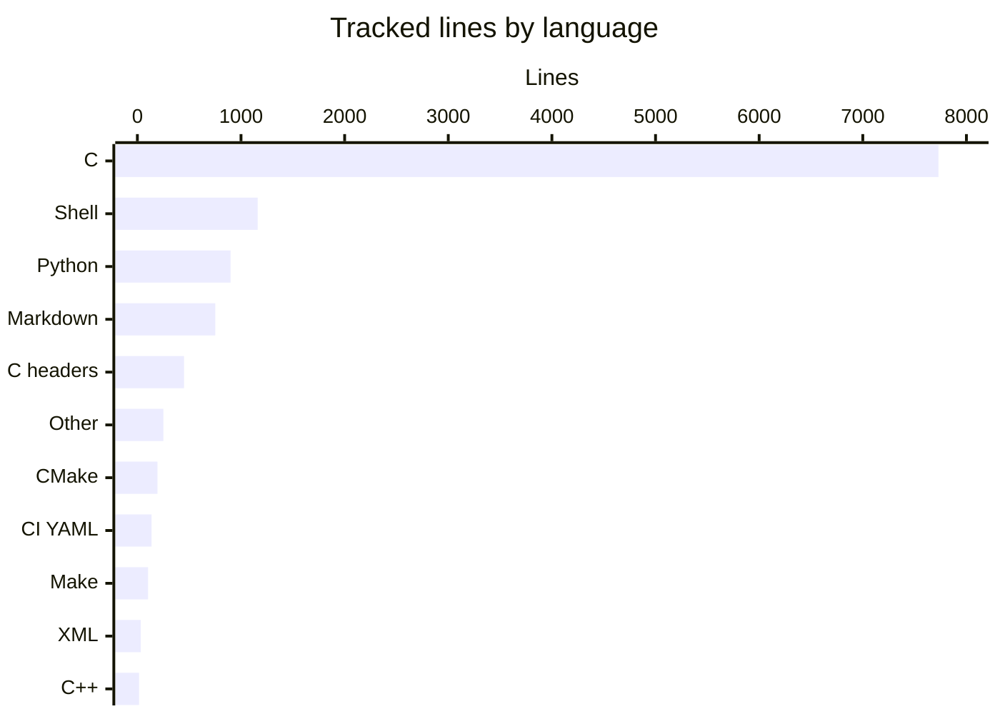
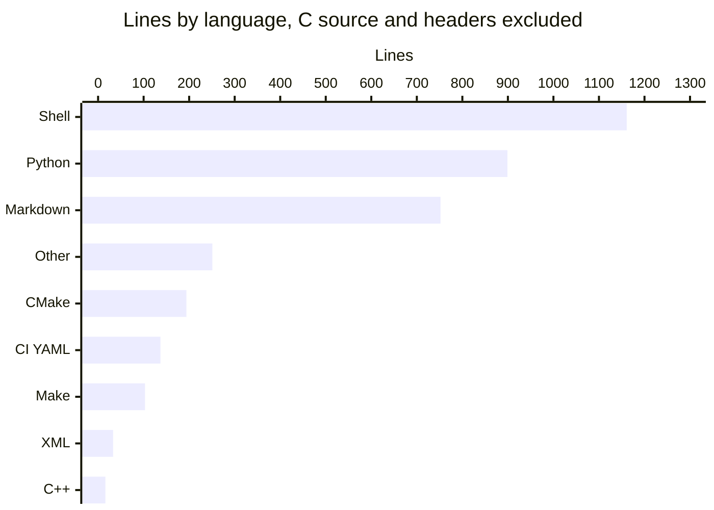

# By the numbers

Data collected on 2026-10-13. Every count below was measured on `main` at commit `037e2bf` (version 0.2.0): `wc -l` over the files tracked by Git, `git log --numstat` for churn, and the historical measurements recorded in `docs/contract.md` and `README.md`. Line counts cover the 65 tracked text files; the two binary fonts (`fonts/DejaVuSans.ttf`, `tests/corpus/truncated-hmtx.ttf`) count as files but not as lines.

## Size at a glance

| Measure | Value |
| --- | --- |
| Tracked files | 67 (65 text, 2 binary fonts) |
| Tracked text lines | 11,726 |
| Production C lines (`src/` plus `include/`) | 4,484 |
| Test code lines (`tests/`) | 5,378 |
| Commits | 9 (8 authored, 1 merge) |
| Lifetime churn | 12,067 lines added, 340 removed |
| Public exported symbols (`libki_xml_pdf.map`) | 9 |
| Largest file by bytes | `fonts/DejaVuSans.ttf` (759,720 bytes) |
| Largest file by lines | `tests/test_stream.c` (3,259 lines) |

## Lines by language

C dominates the tree. The single C test file `tests/test_stream.c` (3,259 lines) holds more lines than all shell, Python and Markdown combined.

The scale hides the smaller groups, so here they are again without C:

| Language | Lines | Files | Where |
| --- | --- | --- | --- |
| C (`.c`) | 7,730 | 14 | `src/` 4,052, `tests/` 3,318, `examples/` 360 |
| C headers (`.h`) | 450 | 9 | `src/` 288, `include/ki_xml_pdf.h` 144, `examples/catalog_map.h` 18 |
| Shell | 1,161 | 6 | `tests/verify.sh` 556 plus five more harnesses |
| Python | 899 | 4 | `tests/` harnesses: catalog, CLI pipeline, fuzz, large proof |
| Markdown | 752 | 10 | 4 at the root, 6 in `docs/` |
| CMake and pkg-config templates | 194 | 6 | `CMakeLists.txt`, `tests/consumer/CMakeLists.txt`, 4 templates in `cmake/` |
| Other | 251 | 7 | license, `baseline-manifest.json`, linker map, font notice, expected text, `.gitignore` |
| CI YAML | 137 | 1 | `.github/workflows/ci.yml` |
| Make | 103 | 1 | `Makefile` |
| XML fixtures and examples | 33 | 6 | `examples/` and `tests/` |
| C++ | 16 | 1 | `examples/consume.cpp` |
| Total | 11,726 | 65 text files | plus 2 binary fonts |

## Where the lines live

| Area | Files | Lines | Share |
| --- | --- | --- | --- |
| `src/` (library and CLI) | 15 | 4,340 | 37.0% |
| `tests/` | 17 | 5,410 | 46.1% |
| `examples/` | 11 | 436 | 3.7% |
| Markdown at the root | 4 | 390 | 3.3% |
| `docs/` | 6 | 362 | 3.1% |
| Build and CI | 9 | 448 | 3.8% |
| `include/` | 1 | 144 | 1.2% |
| Meta and licensing | 4 | 196 | 1.7% |

Test material is the largest area of the repository: the `tests/` directory alone holds 46.1% of all tracked lines, more than the production code it checks.

## Average file size by directory

| Directory | Text files | Lines | Average lines per file |
| --- | --- | --- | --- |
| `tests/` | 16 | 5,410 | 338 |
| `src/` | 15 | 4,340 | 289 |
| `include/` | 1 | 144 | 144 |
| `docs/` | 6 | 362 | 60 |
| `examples/` | 11 | 436 | 40 |
| `cmake/` | 4 | 55 | 14 |

Tests have both the largest files and the largest average. The examples stay deliberately small: the biggest, `examples/catalog_map.c`, is 213 lines, about the size `src/page_sink.c` was (206 lines) before OSR-90 removed it.

## Largest files

| File | Lines |
| --- | --- |
| `tests/test_stream.c` | 3,259 |
| `src/xml_parse.c` | 1,163 |
| `src/convert.c` | 861 |
| `src/pdf_write.c` | 774 |
| `tests/verify.sh` | 556 |
| `src/font.c` | 340 |
| `src/report.c` | 263 |
| `tests/catalog_verify.py` | 244 |
| `tests/cli_pipeline.py` | 240 |
| `tests/large_proof.py` | 230 |

The parser, the driver and the PDF writer are the biggest production pieces, in that order. The largest file in the repository is a test file, 2.8 times the size of the largest production file.

## Commit history

Nine commits across two active days:

| Day | Commits | Events |
| --- | --- | --- |
| 2026-10-07 | 2 | Public drop `7c62fe4` at 21:10, CI and source-distribution fix `cedcaab` at 21:34 (local +03:00) |
| 2026-10-13 | 7 | Six OSR commits between 02:32 and 03:08 UTC, then merge of PR #1 (`037e2bf`) at 06:39 local |

| Week (Mon to Sun) | Commits |
| --- | --- |
| 2026-10-05 to 2026-10-11 (ISO week 41) | 2 |
| 2026-10-12 to 2026-10-18 (ISO week 42) | 7 |

The 2026-10-13 sprint averages one commit every 7.3 minutes across the six OSR commits. The first commit landed 73% of all lines that have ever been inserted (8,824 of 12,067), which is what a repository looks like when it is published as a finished first release rather than grown in public.

## Churn hotspots

From `git log --numstat` across the eight non-merge commits:

| File | Commits touching it | Lines added | Lines removed |
| --- | --- | --- | --- |
| `tests/test_stream.c` | 3 | 3,259 | 0 |
| `src/xml_parse.c` | 1 | 1,163 | 0 |
| `src/convert.c` | 3 | 906 | 45 |
| `src/pdf_write.c` | 1 | 774 | 0 |
| `tests/verify.sh` | 2 | 559 | 3 |
| `src/font.c` | 1 | 340 | 0 |
| `tests/fuzz_smoke.py` | 2 | 274 | 89 |
| `src/report.c` | 1 | 263 | 0 |
| `README.md` | 3 | 262 | 51 |
| `src/main.c` | 2 | 252 | 32 |

After the initial drop, only three production files changed at all: `src/convert.c` (+58/-45), `src/main.c` (+88/-32) and `include/ki_xml_pdf.h` (+16/-6), all in the 0.2.0 sprint. The rest of `src/` is byte-identical to the first public commit. Most churn after the drop went into tests and documentation: `tests/test_stream.c` gained 566 lines and `README.md` gained 213 across the sprint.

## Bot co-authorship

None. A search for `Co-authored-by` trailers over all nine commit messages returns zero matches, and no commit carries bot attribution. Measured as a share of commits with bot co-author trailers: 0%. All work in the visible history is human-authored.

## Public API surface

`libki_xml_pdf.map` exports exactly 9 symbols in two version nodes:

| Symbol | Version node | Kind |
| --- | --- | --- |
| `ki_convert` | KI_0_1 | current API |
| `ki_convert_file` | KI_0_1 | current API |
| `ki_doc_text` | KI_0_1 | current API |
| `ki_doc_break` | KI_0_1 | current API |
| `ki_doc_fail` | KI_0_1 | current API |
| `ki_options_init` | KI_0_1 | current API |
| `xml2pdf_convert` | KI_0_1 | legacy |
| `xml2pdf_convert_cap` | KI_0_1 | legacy |
| `ki_convert_to_file` | KI_0_2 | added in 0.2.0 |

Everything else in the shared library is local. The three `xml2pdf_debug_*` test hooks declared in `src/convert.h` are not in the map, so the linker keeps them private.

## Test-to-code ratio

Test harness code in `tests/` totals 5,378 lines: `tests/test_stream.c` (3,259), `tests/consumer/report.c` (59), four Python files (899) and six shell files (1,161). Production C in `src/` and `include/` totals 4,484 lines. The ratio is about 1.2 test lines per production line. The single C test binary registers 16 test cases, and the shell and Python harnesses add build integration, CLI pipeline, catalog, fuzz, docs and 1 GiB large-proof runs on top.

## Historical performance

Measured 2026-10-07 on revision `7c62fe4` (Linux 64-bit, GCC, Poppler), as recorded in `docs/contract.md` and `README.md`:

| Scenario | Input bytes | Pages | PDF bytes | Peak RSS | Offset spool |
| --- | --- | --- | --- | --- | --- |
| `records-v1`, whole input | 16,777,313 | 41,944 | 173,535,332 | 2,360 KiB | 671,168 |
| `report-v1`, first 1,000 of 19,522,650 records | 1,073,741,815 | 41 | 1,009,241 | 2,372 KiB | 720 |

Derived from those rows:

- The 2,372 KiB peak is 3.6% of the 64 MiB ceiling that applied to that revision, and 0.22% of the 1 GiB input; the input-to-RSS ratio is roughly 442 to 1. The current acceptance gate is 4096 KiB (4 MiB).
- The 1 GiB conversion took 7.61 seconds, about 141 MB/s of input.
- The offset spool costs 8 bytes per PDF object: about 16 bytes per page in the full `records-v1` run.
- The `records-v1` run expands 16 MiB of XML into a 173.5 MB PDF, a factor of about 10.3.

The scripted gate in `tests/verify.sh` requires large-run RSS at most 4096 KiB, under half the input size, and within 4 MiB of a small run's RSS. See [how the checks work](how-to-contribute/testing.md).

## Related pages

- [Overview](overview/index.md) and [Architecture](overview/architecture.md)
- [The report-v1 profile](features/report-v1.md) and [records-v1](features/records-v1.md)
- [The legacy page sink](systems/page-sink.md) and [Layout and fonts](systems/layout-and-fonts.md)
- [Design decisions](background/design-decisions.md) and [Cleanup opportunities](cleanup-opportunities.md)
- [History](lore.md) and [Fun facts](fun-facts.md)
