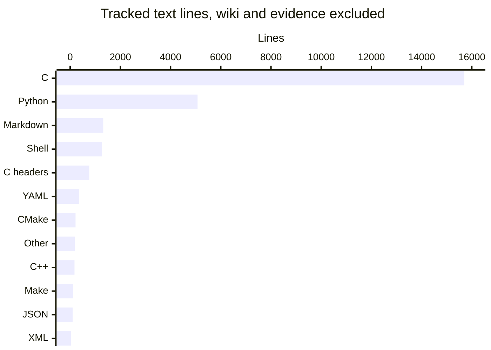

# By the numbers
By Artem.

Snapshot: **2026-10-17**, `d57306903d7a122f3abe84c4d5d9659799d6176f` (0.3.0). These are repository measurements, not a performance promise or an individual contributor ranking.

## Scope and reproducibility

Inventory comes from `git ls-tree -rz d573069`; contents are the corresponding Git blobs, not build products or this wiki's uncommitted refresh. A binary is a blob containing NUL in its first 8,192 bytes: exactly `fonts/DejaVuSans.ttf`, `tests/corpus/truncated-hmtx.ttf` and `tests/corpus/truncated-cmap-184.ttf`.

All size/language tables exclude **all** `droid-wiki/` and `docs/evidence/`, including evidence READMEs as well as generated logs. They retain ordinary documentation, the ADR, fixtures, examples, research harnesses, licenses and build files. Lines mean newline bytes (`wc -l` semantics), including comments/blanks; 13 XML fixtures lack a final newline. Bytes are uncompressed blob bytes. These are not logical source-line counts.

| Measure | Value |
| --- | ---: |
| All tracked files | 811 |
| Excluded wiki / evidence files | 41 / 646 |
| Binary assets excluded | 3 |
| Measured text files / lines / bytes | 121 / 25,304 / 1,110,939 |
| Production C and headers, `src/` + `include/` | 19 files / 6,437 lines |
| Test/research code, `tests/` | 45 files / 16,147 lines |
| Build/configuration files, defined below | 15 files / 844 lines |
| Code across production, tests and examples | 22,980 lines |
| Largest measured text file | `tests/test_stream.c`, 3,655 lines |

Production is nine C translation units (eight library units plus `src/main.c`) and ten headers. Test code is 15 C files (9,646 lines), one C++ file (157), 21 Python files (5,076) and eight shell files (1,268); this includes research tools, not just shipped-feature regression tests. Their ratio is **2.51 test/research lines per production line**, not a coverage percentage.

Build/config means `.github/`'s five YAML files, `CMakeLists.txt`, `tests/consumer/CMakeLists.txt`, all four `cmake/` templates, `Makefile`, `.gitignore`, `baseline-manifest.json` and `libki_xml_pdf.map`. Categories overlap: the consumer CMake file is also under `tests/`. “Code” means `.c`, `.h`, `.cpp`, `.py`, `.sh` only.

## Lines by language

| Language/type | Files | Lines |
| --- | ---: | ---: |
| C | 28 | 15,702 |
| Python | 21 | 5,076 |
| Markdown | 14 | 1,319 |
| Shell | 8 | 1,268 |
| C headers | 11 | 761 |
| YAML | 5 | 358 |
| CMake | 5 | 215 |
| Other | 8 | 184 |
| C++ | 2 | 173 |
| Make | 1 | 118 |
| JSON | 1 | 97 |
| XML | 17 | 33 |
| **Total** | **121** | **25,304** |

Classification uses suffixes; `CMakeLists.txt` and `.cmake.in` are CMake. “Other” includes `cmake/ki_xml_pdf.pc.in`, linker map, notices, checksums and expected text. Tiny XML line counts can hide long single-line fixtures such as `tests/fixture.xml`.

## Average file size by directory

Directories are recursive first-level groups; `(root)` means files directly at the repository root. Same text-only exclusions as above; means are rounded to one decimal.

| Directory | Files | Lines | Mean lines | Mean bytes |
| --- | ---: | ---: | ---: | ---: |
| `src/` | 18 | 6,201 | 344.5 | 10,316.6 |
| `include/` | 1 | 236 | 236.0 | 10,005.0 |
| `tests/` | 61 | 16,190 | 265.4 | 11,674.3 |
| `examples/` | 11 | 438 | 39.8 | 1,157.7 |
| `docs/`, excluding evidence | 7 | 491 | 70.1 | 7,553.3 |
| `cmake/` | 4 | 59 | 14.8 | 570.2 |
| `.github/` | 6 | 368 | 61.3 | 2,160.2 |
| `fonts/`, notice only | 1 | 78 | 78.0 | 3,859.0 |
| `(root)` | 12 | 1,243 | 103.6 | 9,866.1 |

The largest production files are `src/xml_parse.c` (1,482 lines), `src/pdf_write.c` (1,112), `src/convert.c` (994) and `src/font.c` (662).

## Recent history and churn

All 68 reachable commits are in October: **54 non-merges and 14 merges**, on four active UTC dates (October 7: 2; October 13: 8; October 16: 32; October 17: 26). Dates use committer timestamps converted to UTC; activity includes merges.

| Recent Monday–Sunday week | Commits |
| --- | ---: |
| 2026-09-07–09-13 | 0 |
| 2026-09-14–09-20 | 0 |
| 2026-09-21–09-27 | 0 |
| 2026-09-28–10-04 | 0 |
| 2026-10-05–10-11 (ISO 41) | 2 |
| 2026-10-12–10-18 (ISO 42, partial) | 66 |

| Recent month | Commits |
| --- | ---: |
| 2026-07 | 0 |
| 2026-08 | 0 |
| 2026-09 | 0 |
| 2026-10, through snapshot | 68 |

Last-90-day churn is `git log d573069 --no-merges --since=2026-07-20T00:00:00Z --until=2026-10-18T00:00:00Z --numstat --no-renames`. Exclude wiki, evidence and binary entries; retain deleted source paths. It totals **27,083 additions / 1,766 deletions**. The initial public import is included, so high churn is not automatically maintenance trouble. Git numstat counts an unterminated final line, unlike the size tables.

| Hotspot, ordered by additions + deletions | Touching non-merges | Added | Removed |
| --- | ---: | ---: | ---: |
| `tests/test_stream.c` | 19 | 3,753 | 98 |
| `src/xml_parse.c` | 4 | 1,725 | 243 |
| `src/pdf_write.c` | 12 | 1,380 | 268 |
| `src/convert.c` | 13 | 1,097 | 103 |
| `src/font.c` | 6 | 789 | 127 |
| `tests/research_table.py` | 1 | 762 | 0 |
| `tests/test_xml_subset.c` | 1 | 751 | 0 |
| `tests/test_layout_wrap.c` | 1 | 686 | 0 |

### Explicit bot attribution: a lower bound

Search author name/email and `Co-authored-by:` trailers, case-insensitively, for `[bot]`, the whole word `bot`, or `factory-droid`. There are **0 bot-authored commits**, **30 with a bot co-author**, and **30 in their union**: **30/68 = 44.1%** of all reachable commits, or **30/54 = 55.6%** of non-merges. The denominator includes the initial import; merges have no matching trailer. All 30 matching commits explicitly credit `factory-droid[bot]`.

This measures visible attribution only. It cannot establish how much code was AI-generated, and absent trailers do not prove work was unaided.

## Include depth and export surface

Resolve literal quoted includes relative to their source file, then the project roots `include/`, `src/`, `examples/`; traverse existing tracked C/C++ files and headers only. Exclude system headers, generated build dependencies and evidence snapshots. There are no unresolved quoted includes. Maximum simple-chain depth is **four include edges / five files**, with six tied paths:

- Each of `src/convert.c`, `src/layout.c` and `tests/test_stream.c` reaches `src/layout.h` → `src/pdf_write.h` → `src/geometry.h` → `src/font.h`.
- The same three origins also reach `src/layout.h` → `src/pdf_write.h` → `src/info.h` → `include/ki_xml_pdf.h`.

`libki_xml_pdf.map` declares **13 function exports**, excluding the three ELF version-node names and local implementation/test hooks:

| Version node | Functions |
| --- | --- |
| `KI_0_1` (8) | `ki_convert`, `ki_convert_file`, `ki_doc_text`, `ki_doc_break`, `ki_doc_fail`, `ki_options_init`, `xml2pdf_convert`, `xml2pdf_convert_cap` |
| `KI_0_2` (1) | `ki_convert_to_file` |
| `KI_0_3` (4) | `ki_config_init`, `ki_convert_cfg`, `ki_convert_file_cfg`, `ki_convert_to_file_cfg` |

These are the source-controlled export rules, not `nm` counts from an arbitrary local build. See [C API](api/c-api.md).

## Measurements are revision-scoped

`docs/evidence/osr-82-heap-profile/README.md` measured **de8ba0e**, before the October 17 memory changes: median RSS 2,728 KiB for full 16 MiB report-v1, 2,688 KiB for records-v1, and 2,728 KiB for report-v1 limited to 1,000 records. These are not measurements of this HEAD. `tests/verify.sh` now gates converter RSS at **4,096 KiB**, below half the large input and within small-run RSS +4 MiB; that fixture gate is not a universal RSS bound.

## Key source files and related pages

| Sources | Purpose |
| --- | --- |
| `include/ki_xml_pdf.h`, `libki_xml_pdf.map` | Version, public layouts and export nodes |
| `src/convert.c`, `src/layout.h`, `src/pdf_write.h`, `src/geometry.h`, `src/info.h`, `src/font.h` | Production inventory and include-chain evidence |
| `tests/test_stream.c`, `tests/verify.sh`, `tests/resource_baseline.py` | Test size and measured resource gates |
| `docs/evidence/osr-82-heap-profile/README.md` | Historical heap/RSS provenance, excluded from code counts |

[Overview](overview/index.md) · [Architecture](overview/architecture.md) · [PDF writer](systems/pdf-writer.md) · [Resource limits](features/resource-limits.md) · [Testing](how-to-contribute/testing.md) · [Design decisions](background/design-decisions.md) · [History](lore.md)
