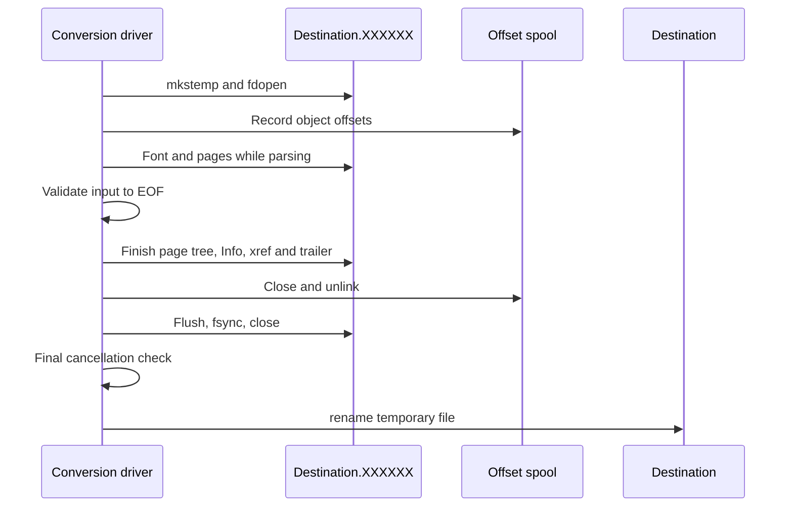

# Atomic output
Active contributors: Artem

File destinations are published only after the entire XML is validated and the PDF is finished, flushed, synced and closed. `src/convert.c` writes a temporary sibling and renames it over the destination; ordinary failures preserve the previous destination and remove unpublished output.

## Publication boundary

This behavior applies to `ki_convert_file`, `ki_convert_to_file` and their `_cfg` variants. Callback/stdout destinations have a different [partial-output contract](streaming-io.md).

Input validation and page emission interleave. `pdf_free` releases the spool before the final file-publication steps.

`make_temp` appends `.XXXXXX` to the output path and uses `mkstemp`. Keeping the temporary PDF in the destination directory puts rename on the same filesystem. `--temp-dir` controls only the separate offset spool, not this PDF.

`convert_streams` completes layout/PDF, flushes/frees the writer, checks the raw output stream, performs `fflush`/`fsync`/`fclose`, checks cancellation again and calls `rename`. A success summary is emitted only after publication. Failure unlinks the temporary sibling.

There is no directory `fsync` after rename. The implementation provides atomic replacement and a synced file, not a documented power-loss durability guarantee for the directory entry.

## Same-file and symlink rules

`same_file` in `src/convert.c` first compares device/inode from `stat`, then resolved path identities. This rejects an input/output pair naming the same file through identical paths, dotted paths, hard links or symlinks.

A destination symlink to a different file is replaced by the new PDF directory entry rather than followed for writing. The target behind that symlink is not overwritten. Successful replacement creates the new file's identity; preserving the old file's inode/permissions is not the publication contract.

These path checks are ordinary filesystem identity checks, not a lock against hostile concurrent directory/path changes. See [Security](../security.md).

## Failure outcomes

| Outcome | Destination | Temporary state |
| --- | --- | --- |
| Static invalid options/config/metadata | Untouched | No files opened by conversion |
| Same-file rejection or file input open failure | Untouched | No temporary PDF |
| Font-dependent geometry rejection | Untouched | Opened temporary/spool files removed |
| Late XML/profile/font/I/O/quota/cancel failure | Previous file unchanged, or absent destination stays absent | Unpublished temporary PDF and spool removed |
| Flush/fsync/close/rename failure | Not successfully published | Temporary PDF removed |
| Success | Replaced with finished PDF | PDF renamed; spool removed |
| SIGKILL/process crash | No cleanup guarantee; publication depends on whether rename happened | Temporary PDF/spool may remain |

Cancellation is checked during input, between events and throughout finishing/publication. Once rename succeeds, later cancellation cannot roll the destination back. The CLI handles SIGINT/SIGTERM cooperatively; the library installs no signal handlers.

For callback input, the library cannot compare an opaque reader's underlying resource with the destination path. It still never writes the destination in place. Caller-owned reader resources stay open until the caller closes them.

## Validation and change entry points

The feature is part of one pipeline implementation unit, with shared failure groups in `tests/test_stream.c` rather than a separate atomic-output C file. Those tests cover same-file aliases, injected read/page/publish failures, cancellation and killed-process cleanup boundaries.

`tests/cli_pipeline.py`, `tests/catalog_verify.py` and `tests/integration_check.py` check late errors, quota failures, preserved destination bytes and temporary/spool cleanup. Combined tests exercise both an existing and an absent destination.

- Temp naming/creation: `make_temp` and `convert_file_stream`.
- File identity: `same_file` and `output_identity`.
- Publication/cancellation: finishing block of `convert_streams`.
- Spool cleanup: `pdf_free` in `src/pdf_write.c`.

Keep late-input validation and close/flush errors in the success decision. Do not bypass rename for a callback-input file route.

## Key source files

| File | Role |
| --- | --- |
| `src/convert.c` | Identity checks, temporary PDF, publication and cleanup |
| `src/pdf_write.c` | PDF completion, counted stream and offset spool cleanup |
| `include/ki_xml_pdf.h` | File/callback ownership and cancellation contract |
| `tests/test_stream.c` | Same-file, injected failures, signals and preserved output |
| `tests/cli_pipeline.py` | CLI late failure, quotas and real cancellation |
| `tests/integration_check.py`, `tests/catalog_verify.py` | Combined/custom-schema preservation checks |

Related: [Conversion pipeline](../systems/conversion-pipeline.md), [Resource limits](resource-limits.md), [CLI](cli.md).
