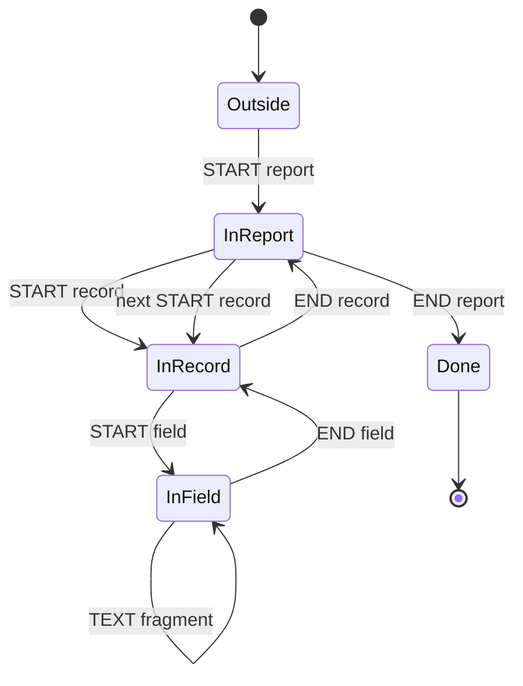

# report-v1

Active contributors: Artem Klen

`report-v1` is the project-owned profile for sequential reports: a fixed `report` / `record` / `field` grammar with validation, explicit record selection and summary counters. The mapper is `report_map` in `src/report.c`, its state is the fixed-size `Report` struct in `src/report.h`, and the full contract is `docs/report-v1.md`.

## Purpose

Render large report XML into a text PDF while reading each record once and keeping nothing per record. The profile validates the whole document, including skipped records, before a file destination is published, and reports counts of total, selected and skipped records both in the PDF and in `KiResult`.

## Key abstractions

| Abstraction | Path | Role |
| --- | --- | --- |
| `report_map` | `src/report.c` | Event dispatcher: start/end/text handlers for the three element names |
| `Report` | `src/report.h` | Fixed state: three nesting flags, selection and counter fields, one 256-byte pending field name |
| `report_init` | `src/report.c` | Zeroes state, clamps `offset` and `limit` to nonnegative values |
| `fail_rule` / `fail_attr` | `src/report.c` | Compose rule messages with the current byte offset |
| `docs/report-v1.md` | `docs/report-v1.md` | Profile contract: grammar, whitespace, selection, acceptance evidence |

## Grammar

```xml
<?xml version="1.0" encoding="UTF-8"?>
<report version="1" title="Сводка">
  <record id="1">
    <field name="Название">Запись 1</field>
    <field name="Статус">Готово</field>
  </record>
  <record id="2">
    <field name="Название"><![CDATA[Запись 2]]></field>
    <field name="Примечание"></field>
  </record>
</report>
```

| Element | Attributes | Content |
| --- | --- | --- |
| `report` | Required `version="1"` and nonempty `title`; no others | Zero or more `record` elements |
| `record` | Optional nonblank `id`; no others | One or more `field` elements |
| `field` | Required nonempty `name`; optional `xml:space` of `default` or `preserve` | Text, CDATA and supported character references; no nested elements |

One root, UTF-8, no namespaces. Attribute names containing a colon are rejected except `xml:space` on `field`, and names beginning with `xmlns` are always rejected. Nonempty here means at least one non-whitespace character: `title`, `name` and a supplied `id` must contain one. IDs need not be unique, because retaining a growing set of IDs is outside the streaming contract; without an `id` the original record number is used, starting at 1. Duplicate field names are allowed and source order is preserved. `title`, `id` and `name` are bounded by the parser's 255 decoded UTF-8 bytes attribute limit; field values are not buffered, so their length is bounded by output quotas rather than a field buffer.

## State machine



The `Report` struct stores this as three flags (`in_report`, `in_record`, `in_field`) plus `saw_field`, `skipping` and `value_started`; its size does not grow with the number of records. Whitespace-only text is ignored in every state. Any transition not shown fails with one of the rules below. There is no separate end-of-input event: required children are checked when an element closes, and the mapper relies on the library for truncated or malformed XML.

## Validation rules and messages

Every failure goes through `ki_doc_fail` with `KI_CAUSE_PROFILE`, so the process status is 1. `fail_rule` appends the byte offset to the rule, producing for example `profile: record nesting at byte 57`. The offset is the parser position after the event's bytes were consumed, taken from `KiEvent.byte_offset` at the top of `report_map`.

| Message (rule text in `src/report.c`) | Raised when |
| --- | --- |
| `profile: report nesting` | `report` starts inside any element, or ends while a `record` or `field` is open |
| `profile: record nesting` | `record` starts outside `report` or inside another `record`/`field`, or ends outside a `record` or inside a `field` |
| `profile: field nesting` | `field` starts outside a `record` or inside another `field`, or ends outside a `field` |
| `profile: namespace` | A namespaced or `xmlns` attribute appears on any element, or the `report` element name itself contains a colon (a colon in a `record` or `field` name instead fails as an unknown element) |
| `profile: report version` | `version` is missing or not `"1"` |
| `profile: report title` | `title` is missing or whitespace only |
| `profile: empty id` | `record` has an `id` with no non-whitespace character |
| `profile: field name` | `field` has no non-whitespace `name` |
| `profile: xml:space` | `xml:space` is neither `default` nor `preserve` |
| `profile: empty record` | A `record` closes with no `field` |
| `profile: structural text` | Non-whitespace text appears outside a `field` |
| `profile: record counter` | A record counter would overflow 64 bits |
| `profile: unknown element` | A start or end event for anything but `report`, `record` or `field` |
| `profile: unknown attribute <attr> on <element> at byte <n>` | An attribute outside the allowed set for that element |

## Selection

`KiOptions.record_offset` (CLI `--record-offset`) is the number of initial records to skip; 0 starts at the beginning. `KiOptions.record_limit` (`--record-limit`) is the maximum number of records selected after that offset; 0 selects all remaining records. A record is taken when its 1-based index is greater than the offset and, if a limit is set, fewer than the limit have been selected so far. Selection follows source order, not IDs, and an offset beyond the end selects nothing. Skipped records keep their grammar validated: the `skipping` flag only suppresses output, and the library still reads the entire XML after the limit is reached, so a late error cannot hide behind a completed selection.

## Rendering and counters

The title is printed once. Each selected record is headed by the literal Russian label `Запись ` followed by its ID or its original record number; this label is part of the existing profile and stays unchanged. Fields render as `name: value`, with the label emitted before the first value fragment; a field with no fragments renders as `name:`. All spaces inside a value are significant, including leading and trailing spaces and a space at a TEXT/CDATA boundary, and both `xml:space="default"` and `xml:space="preserve"` keep the full value. Physical line and page breaks follow the shared layout rules.

When the report closes, three lines are emitted with exact labels: `Всего записей: N`, `Выбрано записей: S` and `Пропущено записей: N-S`. The application receives the same numbers through `KiResult.report_total`, `KiResult.report_selected` and `KiResult.report_skipped`. An empty `report` renders its title and three zero counters.

The complete small example in `examples/report-v1.xml` produces exactly `examples/report-v1.expected.txt`:

```
Сводка
Запись 1
Название: Запись 1
Статус: Готово
Запись 2
Название: Запись 2
Примечание:
Всего записей: 2
Выбрано записей: 2
Пропущено записей: 0
```

## Historical measurement

`python3 tests/large_proof.py 1073741824` on the first public revision [`7c62fe4`](https://github.com/artemklen/ki_xml_pdf/commit/7c62fe4af72b097885d76a7f9f897492f5c4c2d5), ordinary build, measuring only the `xml2pdf` process:

| Measure | Value |
| --- | --- |
| XML input | 1,073,741,815 bytes |
| Total records | 19,522,650 |
| Selected records | 1000 |
| Converter peak RSS | 2372 KiB |
| PDF pages | 41 |
| PDF output | 1,009,241 bytes |
| Metadata spool | 720 bytes |
| Conversion time | 7.61 seconds |

The selected text matched an independent oracle, and `pdftotext` read pages 1, 21 and 41 under a separate 1 GiB address-space limit. The time is not an SLA, and no comparison with other converters is claimed.

## Integration points

- `convert_streams` in `src/convert.c` selects `report_map` when `KiOptions.map` is `NULL` and `KiOptions.profile` is `KI_PROFILE_REPORT`; it passes `record_offset` and `record_limit` through `report_init` and copies the counters into `KiResult` at the end.
- The CLI selects this profile with `--profile report-v1`; the API example is `examples/report.c`.
- Font, quota and XML failures keep their own causes (`KI_CAUSE_FONT`, `KI_CAUSE_RESOURCE`, `KI_CAUSE_XML`) and are not reported as profile errors.

## Entry points for modification

- Grammar or rule changes: `start_report`, `start_record`, `start_field`, `on_text`, `end_field`, `end_record`, `end_report` in `src/report.c`. Keep the state fixed-size and update the rule table and oracle fixtures together.
- New counters: add fields to `Report` in `src/report.h`, emit them in `end_report`, and mirror them in `KiResult` in `include/ki_xml_pdf.h` (a struct layout change needs a minor version bump before 1.0).
- Every change needs fixtures on both sides: positive output in `examples/report-v1.expected.txt`, negative cases in the test suites (`tests/test_stream.c`, `tests/cli_pipeline.py`, `tests/verify.sh`).

## Key source files

| File | Contents |
| --- | --- |
| `src/report.c` | Mapper, rules, selection, counters, Russian labels |
| `src/report.h` | `Report` state struct and `report_init` / `report_map` declarations |
| `docs/report-v1.md` | Full profile contract and acceptance evidence |
| `examples/report-v1.xml`, `examples/report-v1.expected.txt` | Fixture and oracle used by CLI and CMake tests |
| `examples/report.c` | API usage with `KI_PROFILE_REPORT` |
