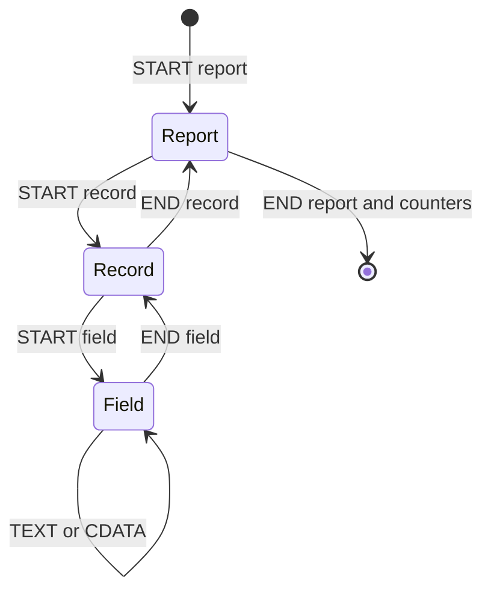

# report-v1
Active contributors: Artem

`report-v1` renders the project's fixed report/record/field grammar as sequential text, with explicit record selection and summary counters. `src/report.c` validates every record, even when selection suppresses its output.

## Grammar

```xml
<report version="1" title="Сводка">
  <record id="1">
    <field name="Название">Запись 1</field>
    <field name="Статус"><![CDATA[Готово]]></field>
  </record>
</report>
```

| Element | Attributes | Children/content |
| --- | --- | --- |
| `report` | Required `version="1"` and nonblank `title` | Zero or more `record` |
| `record` | Optional nonblank `id` | One or more `field` |
| `field` | Required nonblank `name`; optional `xml:space="default|preserve"` | Text/CDATA/references, no nested elements |

Unknown elements/attributes, namespaces/`xmlns`, wrong order/nesting, missing values, empty records and non-whitespace structural text fail. `xml:space` is permitted only on `field`. Nonblank means containing a character other than space/tab/CR/LF. Attribute limits are 255 decoded UTF-8 bytes, not characters.

Duplicate IDs and field names are allowed; no document-wide uniqueness set is retained. IDs are labels, not selection keys. Without an ID the original 1-based record number is used.

## State and flow

`Report` in `src/report.h` has nesting flags, counters, selection flags and one 256-byte pending field name. A whole field/record/document is never buffered.



`report_map` receives public START/TEXT/END events. Field labels are emitted at the first nonempty value fragment; closing an empty field emits its bare label/colon. Structural whitespace is ignored, but whitespace inside fields is significant, including leading/trailing spaces and TEXT/CDATA boundaries. Both accepted `xml:space` values preserve full field content.

The subsystem is one C implementation unit with profile groups in the shared `tests/test_stream.c`, not a dedicated report C test file. Independent CLI/resource oracles complement those groups (`tests/cli_pipeline.py`, `tests/resource_oracle.py`, `tests/large_proof.py`).

## Selection and counters

Select it with `--profile report-v1` or `opt.profile = KI_PROFILE_REPORT`, leaving `opt.map` NULL.

- `record_offset` skips N initial records; 0 starts at the beginning.
- `record_limit` selects at most N after that offset; 0 means all remaining.
- Selection follows source order. An offset past EOF selects none.
- Reaching the limit does not stop reading. Skipped records still receive XML and profile validation.
- Skipped field values are not rendered, so body-font glyph lookup is not performed on them.

The title prints once. Selected records start with `Запись <id or number>`, then fields as `name: value`, or `name:` when empty. Root closure emits:

```text
Всего записей: N
Выбрано записей: S
Пропущено записей: N-S
```

These Russian labels are part of the profile. `KiResult.report_total`, `report_selected` and `report_skipped` return the same counts on success. A zero-record report still renders its title and zero counters. The report's visible title is independent of [PDF Info Title](document-information.md).

## Errors and layout

`start_report`, `start_record`, `start_field`, `on_text` and end handlers in `src/report.c` enforce grammar. Rule failures call `ki_doc_fail`, producing status 1 / `KI_CAUSE_PROFILE` and consumed `line/column/byte` positions; unknown-attribute messages name both attribute and element.

Examples include `profile: report version`, `profile: field name`, `profile: empty record` and `profile: structural text`. Record-counter overflow currently also follows the `profile: record counter` failure path, not the writer's quota path.

XML, font, I/O and resource failures keep their separate causes. Selected values use shared word wrapping and configured geometry, not fixed-width tables. A late error preserves [atomic file output](atomic-output.md), but cannot retract already accepted [callback/stdout bytes](streaming-io.md).

## Change entry points and validation

- Grammar/labels/selection: handlers in `src/report.c`; keep fixed state and source-order semantics.
- Shared API counters: do not append fields to established `KiResult` casually; consult [C API](../api/c-api.md).
- Fixtures: `examples/report-v1.xml` and `examples/report-v1.expected.txt`, plus positive/negative shared tests.
- Cross-feature behavior: `tests/integration_check.py` covers selection with geometry, wrapping, fonts, Flate, Info and all I/O routes.

`docs/report-v1.md` is the grammar contract but retains historical default-layout/acceptance measurements. Current geometry and RSS gates are described on [Page geometry](page-geometry.md) and [Resource limits](resource-limits.md); do not treat old resource budgets as current measurements.

## Key source files

| File | Role |
| --- | --- |
| `src/report.c`, `src/report.h` | State machine, selection, validation and labels |
| `src/convert.c` | Dispatch, event positions and result counters |
| `docs/report-v1.md` | Grammar/whitespace contract and historical evidence |
| `examples/report.c` | Public API selection example |
| `examples/report-v1.xml`, `examples/report-v1.expected.txt` | Small report and independent expected text |
| `tests/test_stream.c`, `tests/integration_check.py` | Profile cases and combined integration |
| `tests/resource_oracle.py` | Streaming full/selected output oracle |

Related: [Custom mappers](custom-mappers.md), [Conversion pipeline](../systems/conversion-pipeline.md), [Testing](../how-to-contribute/testing.md).
