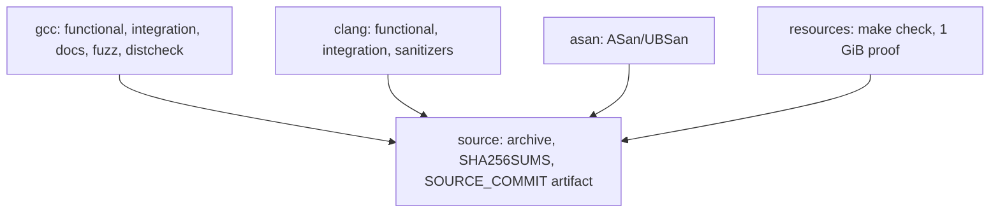

# Tooling

Two build systems cover the repository: GNU Make for development and CI, CMake for out-of-tree and consumer builds. This page lists every target, the compiler flags, the exported symbol map, version derivation, and how the CI jobs depend on each other.

## Make targets

From `Makefile`; run from the repository root.

| Target | What it does |
| --- | --- |
| `all` (default) | Builds `xml2pdf` from `src/main.c` and `libki_xml_pdf.a` |
| `test` | Builds `test_stream` (`-pthread -Wl,--wrap=fsync`) and runs it |
| `check` | `make clean`, `make test`, `tests/verify.sh`, `make example`, `python3 tests/cli_pipeline.py`, `python3 tests/catalog_verify.py` |
| `test-san` | Builds `test_stream_san` with ASan+UBSan and runs it with fatal diagnostics |
| `example` | Builds `examples/consume`, `examples/report`, `examples/catalog`, `examples/consume_cpp` |
| `install` | Installs the CLI, both libraries, the header, font, notices, CMake package and pkg-config file |
| `dist` | Creates `ki_xml_pdf-<version>.tar.gz` from Git HEAD and prints its SHA-256 |
| `distcheck` | `dist`, then `tests/distcheck.sh` on the archive |
| `print-version` | Prints the version parsed from `include/ki_xml_pdf.h` |
| `print-dist-name` | Prints the archive name derived from Git HEAD |
| `clean` | Removes binaries, objects, dependency files and the `src/.font_prefix` stamp |

Make variables: `CC`, `CXX`, `CFLAGS`, `CXXFLAGS`, `PREFIX` (default `/usr/local`), `DESTDIR` (staging only), `PDFTOTEXT`, `DISTCHECK_ORACLE`, `DISTCHECK_BREAK`.

One detail worth knowing: `src/font.o` depends on the `src/.font_prefix` stamp file, which records `PREFIX`. Installing into a different prefix without rebuilding is caught here, because the compiled font path must follow the install prefix.

## CMake targets

`CMakeLists.txt` requires CMake 3.16, Linux, 64-bit and glibc, and fails configuration otherwise. It defines:

- `ki_xml_pdf_static` and `ki_xml_pdf_shared`, both named `ki_xml_pdf` on disk, with aliases `ki_xml_pdf::static`, `ki_xml_pdf::shared` and `ki_xml_pdf::ki_xml_pdf` (the last follows `BUILD_SHARED_LIBS`). The shared library sets soname `libki_xml_pdf.so.0`, `VERSION`/`SOVERSION` and the version-script link flag.
- `xml2pdf`, linked against the default library variant, with an `$ORIGIN` rpath so the build-tree binary finds the shared library, and `fonts/DejaVuSans.ttf` copied next to it so it finds the font from any working directory.
- `catalog_example` (output name `catalog`) from `examples/catalog_driver.c` and `examples/catalog_map.c`.
- `test_stream` built from the core sources plus `tests/test_stream.c` (internal symbols stay visible for parser tests), linked with `Threads` and `--wrap=fsync`.

Options: `BUILD_SHARED_LIBS` (default `ON`), `BUILD_TESTING` (default on; needs Python 3 at configure time). CTest registers three tests: `stream` (runs `test_stream` in the source directory), `catalog` (`tests/catalog_verify.py` against the built example) and `cli_pipeline` (`tests/cli_pipeline.py` against the built CLI).

## Compiler flags

Both builds use C99 with `-Wall -Wextra -Wpedantic` and `_POSIX_C_SOURCE=200809L`, `-O2 -g -fPIC` in the Makefile default `CFLAGS`. `src/convert.c` and `src/pdf_write.c` also use `_GNU_SOURCE` for `fopencookie`. The sanitizer target adds `-fsanitize=address,undefined -fno-omit-frame-pointer`. Dependency files (`.d`) are generated with `-MMD -MP` so header edits rebuild what needs rebuilding; the `gcc` CI job verifies this by touching `src/layout.h` and checking the binary is newer.

## Symbol map

`libki_xml_pdf.map` fixes the shared-library ABI with version nodes:

```
KI_0_1 { global: ki_convert; ki_convert_file; ki_doc_text; ki_doc_break;
              ki_doc_fail; ki_options_init; xml2pdf_convert; xml2pdf_convert_cap;
         local: *; };
KI_0_2 { global: ki_convert_to_file; } KI_0_1;
```

Everything not listed is `local`. Public functions carry the `KI_API` visibility attribute in `include/ki_xml_pdf.h`. A new public symbol needs a new version node, and `tests/build_integration.sh` plus `readelf` checks keep the soname and linkage honest.

## Version derivation

`include/ki_xml_pdf.h` is the single version source:

- The Makefile parses `KI_XML_PDF_VERSION` with `sed` for `VERSION`, `VERSION_MAJOR` and `VERSION_MINOR`, used by `install` (CMake package and pkg-config files) and `print-version`.
- `DIST_VERSION` is parsed from `git show HEAD:include/ki_xml_pdf.h`, so `make dist` archives HEAD even when the working tree is dirty, and an uncommitted version bump stays out of the archive.
- CMake re-reads the header on every configure (`CMAKE_CONFIGURE_DEPENDS` on the header) and derives the project version, the pkg-config version and the CMake package version from it.
- The CLI prints the same define in `--version`; `tests/verify.sh`, `tests/docs_smoke.sh` and `tests/distcheck.sh` all cross-check the printed version against the header.

## CI jobs

`.github/workflows/ci.yml` runs on pushes to `main`, on pull requests and on manual dispatch, with a concurrency group per ref that cancels stale runs. Every job checks out the PR head commit, not the merge ref. A push to a branch with no open PR triggers nothing.

| Job | Steps |
| --- | --- |
| `gcc` | `make test xml2pdf example`, `tests/cli_pipeline.py`, `tests/catalog_verify.py`, `tests/build_integration.sh`, `tests/docs_smoke.sh`, `tests/fuzz_smoke.py`, the header-dependency check, `make distcheck`, five negative distcheck controls (bad compiler, bad reader, bad oracle, `DISTCHECK_BREAK=license`), `tests/prefix_switch.sh` |
| `clang` | Functional build and tests with `CC=clang`, `tests/build_integration.sh` with Clang, `make test-san` |
| `asan` | `make test-san` with GCC |
| `resources` | `make check` on the uninstrumented build, then `python3 tests/large_proof.py --self-test` and the 1 GiB run |
| `source` | Needs all four jobs above; `make dist`, writes `SHA256SUMS` and `SOURCE_COMMIT`, verifies the tar commit id, uploads the archive with provenance |



The `source` job produces the release artifact only after every gate passes; see [Release and distribution](../deployment.md) for what the artifact contains and how to verify it.

## Related pages

- [Testing](testing.md) for what each suite proves.
- [Release and distribution](../deployment.md) for the artifact and provenance flow.
- [Packaging](../features/packaging.md) for installed files and consumer discovery.
- [Patterns and conventions](patterns-and-conventions.md) for the code rules the flags enforce.
