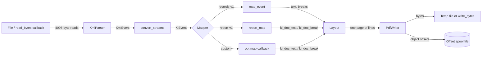
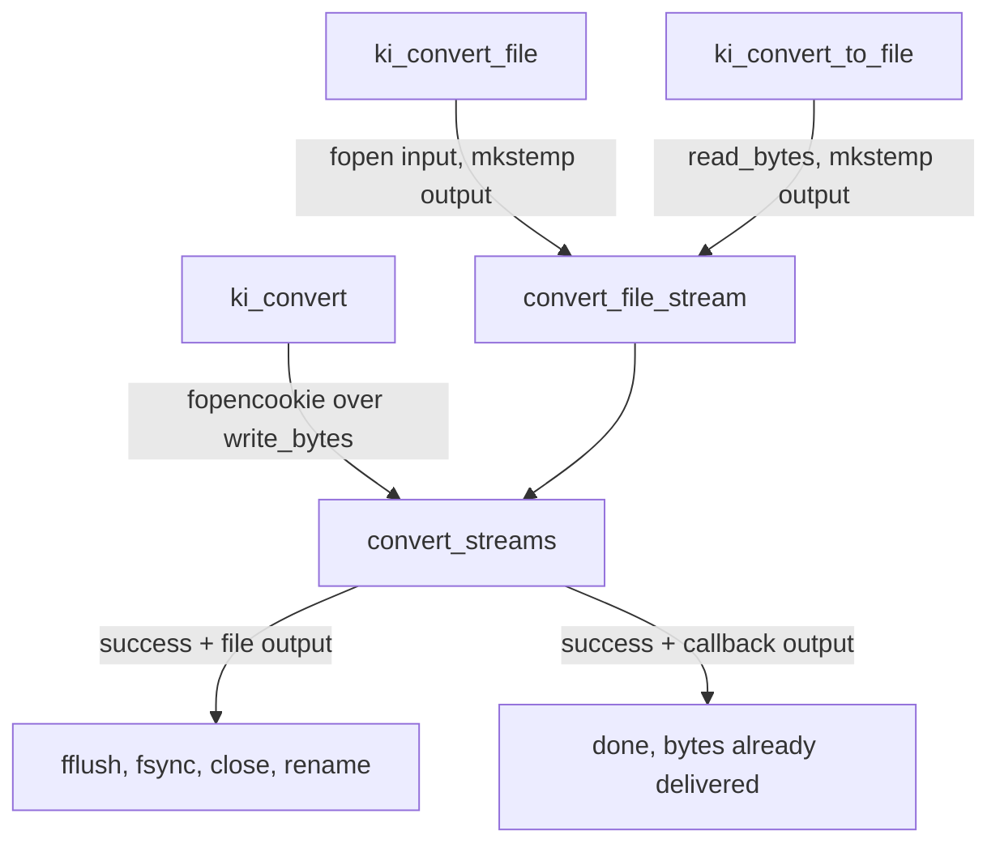

# Architecture

ki_xml_pdf is a single streaming pipeline. Bytes flow from an input source through a pull parser, a mapper, a layout engine and a PDF writer into an output sink. No stage keeps a list that grows with the document.

## Components

| Component | Files | Role |
| --- | --- | --- |
| Public API | `include/ki_xml_pdf.h` | `KiOptions`, `KiResult`, `KiEvent`, `ki_convert*`, `ki_doc_*` |
| Conversion driver | `src/convert.c`, `src/convert.h` | Validates options, wires the stages, maps errors to causes, publishes output |
| XML parser | `src/xml_parse.c`, `src/xml_parse.h` | Bounded pull parser for a documented XML subset |
| Mappers | `src/convert.c` (`map_event`), `src/report.c` | `records-v1` and `report-v1`; a user `map` callback replaces both |
| Layout | `src/layout.c`, `src/layout.h` | UTF-8 decoding, glyph-width wrapping, page assembly |
| Font | `src/font.c`, `src/font.h` | Minimal TrueType reader (`cmap`, `hmtx`, metrics) for a fixed repertoire |
| PDF writer | `src/pdf_write.c`, `src/pdf_write.h` | Append-only PDF, embedded CID font, offsets spooled to a temp file |
| CLI | `src/main.c` | `xml2pdf` argument parsing, signals, file/stdin/stdout selection |
| Legacy page sink | `src/page_sink.c`, `src/page_sink.h` | Fixed byte-grid page buffer; compiled into the library but only exercised by tests |

## Data flow

The driver is `convert_streams` in `src/convert.c`. All three public entry points end up there:

## Memory bounds

Each stage has a fixed footprint:

- **Parser**: `XmlParser` holds a 4096-byte buffer and a 64 × 64-byte stack of open element names (`src/xml_parse.h`).
- **Mapper**: `MapState` is a 64-entry `xml:space` stack; `Report` is a handful of counters and a 256-byte pending name (`src/report.h`).
- **Layout**: `Layout` holds at most 50 lines of up to 1024 bytes (`src/layout.h`).
- **Font**: `FontFace` holds glyph IDs and advances for code points below U+0500 plus 24 punctuation slots (`src/font.h`), alongside the font file bytes.
- **PDF writer**: pages are written and dropped; each object offset is written as 8 bytes into a spool file (`note_offset` in `src/pdf_write.c`). The object count is capped at 8,000,000.

The resource gate in CI requires converter RSS of at most 64 MiB. The historical measurement on revision `7c62fe4` was 2372 KiB for a 1 GiB synthetic report (see [By the numbers](../by-the-numbers.md)).

## Output modes

| Entry point | Input | Output | On failure |
| --- | --- | --- | --- |
| `ki_convert_file` | path | temp file + `rename` | destination preserved, temp removed |
| `ki_convert_to_file` | `read_bytes` | temp file + `rename` | destination preserved, temp removed |
| `ki_convert` | `read_bytes` | `write_bytes` via `fopencookie` | already accepted bytes stay |

The CLI picks one of these based on whether the input or output argument is `-` (`src/main.c`). See [Atomic output](../features/atomic-output.md) and [Streaming I/O](../features/streaming-io.md).

## Language breakdown

The repository is about 10,900 lines across C, shell, Python, Markdown and CMake. C library code in `src/` is roughly 4,500 lines; the largest test file, `tests/test_stream.c`, is 3,259 lines on its own. Details are on [By the numbers](../by-the-numbers.md).

## Related pages

- [Conversion pipeline](../systems/conversion-pipeline.md) for the driver loop and error mapping.
- [XML parser](../systems/xml-parser.md), [Layout and fonts](../systems/layout-and-fonts.md), [PDF writer](../systems/pdf-writer.md) for each stage.
- [Design decisions](../background/design-decisions.md) for why the project uses its own pipeline.
