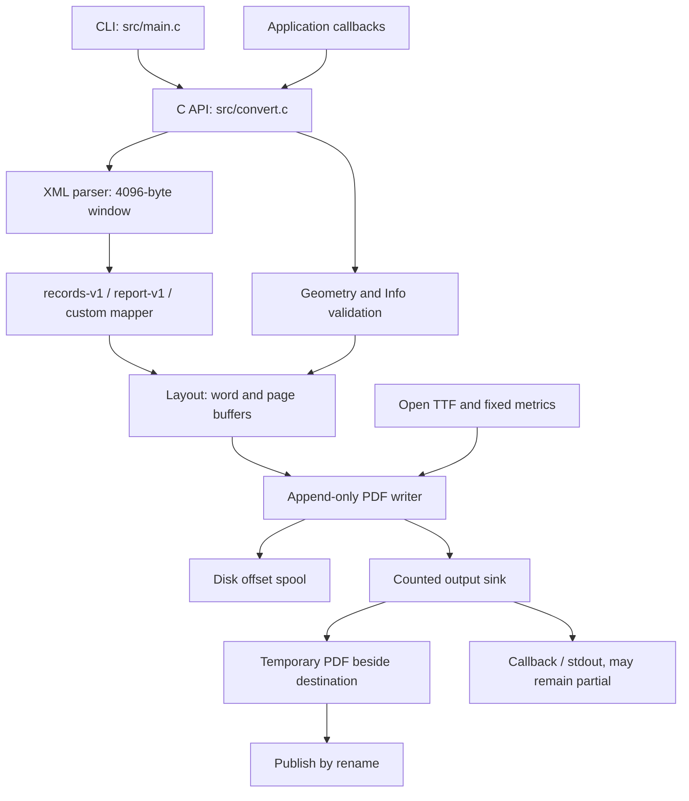

# Architecture

One conversion pulls bounded XML events, maps them to text, lays out a fixed-size page, then appends PDF objects. File and callback entry points share the driver in `src/convert.c`; the CLI in `src/main.c` supplies paths, callbacks, cancellation and diagnostics.

## Components

| Component | Main source | Responsibility |
| --- | --- | --- |
| Conversion driver | `src/convert.c` | Validate options/config, drive events, map failures, manage publication and callback ownership |
| XML parser | `src/xml_parse.c`, `src/xml_parse.h` | Pull events, validate every consumed UTF-8/XML scalar, track consumed positions |
| Report mapper | `src/report.c`, `src/report.h` | Grammar, selection counters and field whitespace |
| Layout | `src/layout.c`, `src/layout.h` | Word wrapping, zero-advance mark grouping, fixed 50-line page |
| Geometry | `src/geometry.c`, `src/geometry.h` | Shared thousandth-point geometry and glyph-ink fitting |
| Document information | `src/info.c`, `src/info.h` | Validate/copy metadata and emit safe PDF strings |
| Font reader | `src/font.c`, `src/font.h` | Bounded table reads, fixed metrics, name extraction, open-file consistency checks |
| PDF writer | `src/pdf_write.c`, `src/pdf_write.h` | Font/page objects, Flate streams, disk-spooled offsets, xref and quotas |

## Memory and disk

`XmlParser` retains a 4096-byte input window and a 64-element nesting stack (`src/xml_parse.h`). `Layout` retains a 1024-byte line buffer, including its pending word, and 50 × 1024 bytes of page text (`src/layout.h`).

The writer lazily allocates **one reusable page-content buffer** for a conversion, rather than allocating and joining a page at every flush. Layout calls `pdf_page_begin`, `pdf_page_line` and `pdf_page_end` directly (`src/layout.c`, `src/pdf_write.c`). A single zlib state is reset between streams, with a fixed output window and font-input scratch space. The font reader keeps an open file and fixed repertoire tables, not the complete TTF (`src/font.h`, `src/pdf_write.c`).

ToUnicode is counted once and written on a second deterministic pass. It uses a fixed 8 KiB stack bitmap, with no heap-backed CMap or heap-backed seen-GID bitmap, and retains the first-code-point-per-GID rule (`src/pdf_write.c`). Offset metadata grows on disk, subject to the spool quota. These changes supersede the allocations profiled on `de8ba0e`; that historical profile is not a current-tree measurement (`docs/evidence/osr-82-heap-profile/README.md`).

## Output and failure boundaries

All output passes a counted sink. Page and font streams use `/FlateDecode` and an indirect length object, so output never needs to seek. The hard total-byte ceiling is 9,999,999,999, independently of user quotas (`src/pdf_write.c`, `src/pdf_write.h`).

A file output is flushed, synced, closed and renamed only after full input validation. A callback output cannot be rolled back. Its first failed write is latched, prevents further callback calls and becomes `KI_CAUSE_IO`; `KiResult.output_bytes` counts accepted callback bytes (`src/convert.c`).

## Build boundaries

The eight core C translation units are shared by Make and CMake. The CLI is a ninth C source file; the public header supports C++ consumers. C99 implementation code, C/C++ tests, Python oracles and shell integration scripts are counted in [By the numbers](../by-the-numbers.md). There is one library, not a workspace of independently versioned packages (`Makefile`, `CMakeLists.txt`).

The removed `page_sink` experiment is not part of the build. Font addons, UTF-16 and tables remain design/research topics, not extra runtime components. See [Design decisions](../background/design-decisions.md).
