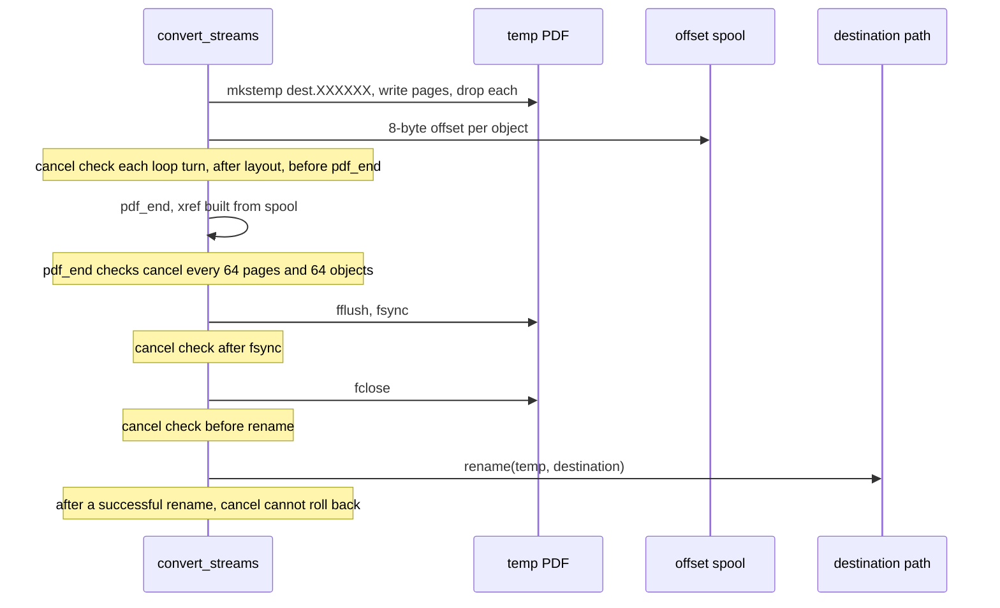

# Conversion pipeline

Active contributors: Artem Klen

The conversion pipeline is the driver that turns an XML byte source into a text PDF. All three public entry points end up in one function, `convert_streams` in `src/convert.c`, which pulls parser events, dispatches them to a mapper, feeds the layout engine and publishes the PDF. This page covers the driver loop, the mapper dispatch order, the error to status mapping and the publication sequence.

## Purpose

The driver owns everything between the input source and the destination: option validation, the pull loop, the event conversion from `XmlEvent` to `KiEvent`, the choice of mapper, the layout and PDF writer lifecycle, cancellation checks, the atomic rename and the filled `KiResult`. Each stage it calls has its own page; this page is the wiring.

## Key abstractions

| Abstraction | Path | Role |
| --- | --- | --- |
| `KiOptions`, `KiResult`, `KiEvent`, `KiDoc` | `include/ki_xml_pdf.h` | Public options, result and event types |
| `KiDoc` definition | `src/convert.c` | Opaque mapper handle wrapping `Layout`, error text and cause |
| `convert_streams` | `src/convert.c` | The shared driver body |
| `convert_file_stream` | `src/convert.c` | Temp-file setup, then `convert_streams` |
| `conv_read` | `src/convert.c` | Read callback the parser pulls through |
| `map_event` | `src/convert.c` | Default `records-v1` mapper |
| `report_map` | `src/report.c` | `report-v1` mapper |
| `XmlParser` | `src/xml_parse.h` | Bounded pull parser |
| `Layout` | `src/layout.h` | Line and page assembly |
| `PdfWriter` | `src/pdf_write.h` | Append-only PDF writer |
| `xml2pdf_convert`, `xml2pdf_convert_cap` | `src/convert.h` | Legacy string-path exports |
| Debug hooks | `src/convert.h` | `xml2pdf_debug_fail_*` test switches |

## How it works

### Entry points

Each entry point zeroes a non-NULL `KiResult` first, validates options with `reject_options`, then reaches `convert_streams` by one of three routes.

- `ki_convert_file(xml_path, pdf_path, opt, result)` in `src/convert.c`: rejects NULL paths, calls `same_file` to refuse an output that resolves to the input, opens the input, rejects a directory input through `fstat`, then `convert_file_stream`.
- `ki_convert_to_file(pdf_path, opt, result)` in `src/convert.c`: requires `opt` and `opt->read_bytes`; `write_bytes` is ignored. Calls `convert_file_stream(NULL, ...)`.
- `ki_convert(opt, result)` in `src/convert.c`: requires both `read_bytes` and `write_bytes`, wraps `write_bytes` in a `ByteSink` behind `fopencookie`, and calls `convert_streams(NULL, out, NULL, NULL, opt, result)` with no destination path, so nothing is renamed.

`reject_options` in `src/convert.c` fails with status 2 and cause `KI_CAUSE_USAGE` when `opt->size` is not `sizeof(KiOptions)`, when any of `max_pages`, `max_output_bytes`, `max_spool_bytes`, `record_offset` or `record_limit` is negative, or when `profile` is neither `KI_PROFILE_RECORDS` nor `KI_PROFILE_REPORT`.

`convert_file_stream` in `src/convert.c` creates the output temp file next to the destination with `make_temp` (`mkstemp` on `<dest>.XXXXXX`), opens it with `fdopen` and a 4096-byte buffer, and hands it to `convert_streams`. If the temp cannot be created, `ENOSPC` and `EDQUOT` become status 4 with `KI_CAUSE_RESOURCE`, anything else becomes status 3 with `KI_CAUSE_IO`. On that path it closes the input, unlinks the temp and frees the name.

### The driver body

`convert_streams` in `src/convert.c` starts with `rc = XML2PDF_ERR_XML` and `cause = KI_CAUSE_XML`, zeroes the result again, sets up `ReadState {fp, opt, bytes, io_failed, cancelled}`, and initializes the parser with `conv_read`. It builds a `PdfConfig` from the options (font, temp dir, the three quotas, cancellation callback) plus the debug fail-at-page hook, calls `pdf_begin_cfg`, then `layout_init`. `use_report` is true only when `opt` is set, `opt->map` is NULL and `opt->profile` is `KI_PROFILE_REPORT`; in that case `report_init` resets the report state.

The loop runs until EOF, an error or a cancellation:

1. Check `opt->cancelled` at the top of every iteration.
2. Call `xml_next`. On `XML_EV_ERROR`, `reader.cancelled` gives status 4 with `KI_CAUSE_CANCEL`, `reader.io_failed` gives status 3 with `KI_CAUSE_IO`, otherwise status 1 with `KI_CAUSE_XML` and the parser error text.
3. On `XML_EV_EOF`, break.
4. Build a `KiEvent` from the `XmlEvent`: copy `kind`, `name`, `text`, `text_len`, `from_cdata`, `byte_offset`, and up to `KI_EVENT_ATTRS` (8) attribute name/value pairs.
5. Dispatch to a mapper and treat a non-zero return as a failure.

`conv_read` in `src/convert.c` is the pull function. It checks cancellation first and returns -1 with `cancelled` set. The `xml2pdf_debug_fail_after_bytes` hook makes it fail once that many bytes were served. `max <= 0` returns 0. When a `FILE` is present it uses `fread` and treats `ferror` or `EINTR` as an I/O failure; otherwise it calls `opt->read_bytes`, rejecting a return below 0 or above `max` as an I/O failure. A return of 0 is EOF. It adds every served count to `st->bytes`.

### Mapper dispatch order

The driver picks exactly one mapper per event, in this order:

| Condition | Mapper | Path |
| --- | --- | --- |
| `opt != NULL && opt->map != NULL` | `opt->map` | caller code |
| else `use_report` (no map, profile `report-v1`) | `report_map` | `src/report.c` |
| else | `map_event` | `src/convert.c` |

A user mapper writes through `ki_doc_text`, `ki_doc_break` and `ki_doc_fail` in `src/convert.c`. `ki_doc_text` sets `KI_CAUSE_FONT` and a `font: U+XXXX` message when the layout rejects a code point. `ki_doc_fail` records the caller's rule string and `KI_CAUSE_PROFILE`. When a mapper returns non-zero and `doc.error` is set, the status is 1 (XML) with the recorded cause, defaulting to `KI_CAUSE_PROFILE`.

### records-v1 whitespace rules

`map_event` in `src/convert.c` keeps a fixed 64-entry `xml:space` stack. A `START` event inherits the parent's preserve flag, overrides it when the element has an `xml:space` attribute equal to `preserve`, pushes the flag, then emits the element name and one line per attribute in the form `name: value`. An `END` event pops the stack and emits a line break. A `TEXT` event is emitted as-is except in one case: a fragment that is entirely whitespace, contains a newline or carriage return, arrives when the current line is empty, and is neither CDATA nor under `xml:space="preserve"` is dropped as indentation. Whitespace inside a line, CDATA whitespace and preserved whitespace stay, so a split `A` + `" "` + `B` renders as `A B`.

### Error to status mapping

`fail_from_pdf` in `src/convert.c` translates the writer's `fail_kind`, `hit_limit` and `fail_errno` into a status and a cause:

| Writer state | Status | Cause | Message |
| --- | --- | --- | --- |
| `fail_kind == 6` | 4 resource | `KI_CAUSE_CANCEL` | `cancelled` |
| `fail_kind == 3` | 1 XML | `KI_CAUSE_FONT` | `font: cannot load` |
| `fail_kind` 1, 4, 5, or `hit_limit` | 4 resource | `KI_CAUSE_RESOURCE` | `resource limit` |
| `fail_errno == ENAMETOOLONG` | 3 I/O | `KI_CAUSE_IO` | `temp path too long` |
| anything else | 3 I/O | `KI_CAUSE_IO` | `cannot create offset file` or `pdf write failed` |

When the writer itself did not fail but the layout rejected a code point, the driver reports status 1 with `KI_CAUSE_FONT` and `font: U+XXXX`. If neither is true, a mapper failure becomes `page write failed` with `KI_CAUSE_XML`.

### Empty document rule

After a clean loop, `layout_finish` flushes the last page. If `pdf_page_count` is still 0, the driver fails with the initial status 1 and `KI_CAUSE_XML` and the message `empty document`. Input that parses but produces no visible text does not publish a file.

### Publication sequence and cancellation

After `layout_finish`, the driver checks the page count, checks cancellation, calls `pdf_end` (which writes the page tree, catalog, xref and trailer), collects metrics, checks cancellation again, then flushes the writer. From there it runs the publish sequence and checks cancellation between steps.

`pdf_end` in `src/pdf_write.c` calls `stop_pdf` at the start, every 64 pages while writing `/Kids`, and every 64 objects while writing the xref. After a successful rename the file is already the destination, so a later cancellation cannot undo it. `ki_convert` has no rename step; its bytes are already with the caller.

### Result and metrics

In the `done` block, `convert_streams` writes the result: `status` is `XML2PDF_OK` when `published` is set, otherwise the failure status; `cause` is `KI_CAUSE_NONE` after a publish; `message` is the last log line. It fills `pages` from `pdf_page_count`, `objects` from `pdf_object_count`, `offset_bytes` and `spool_bytes` from the offset-file size, and `output_bytes` from the bytes written. For `report-v1` it fills `report_total`, `report_selected` and `report_skipped` (`total - selected`). On a publish it logs `xml2pdf: pages=N objects=N offset_bytes=N`.

### Legacy exports and debug hooks

`xml2pdf_convert_cap` and `xml2pdf_convert` in `src/convert.c` (declared in `src/convert.h`) are the older string-path API. They fill `KiOptions` with `log_stderr`, set `max_output_bytes` from `page_cap` (so the legacy "page cap" is applied as an output byte quota, not a page count), call `ki_convert_file`, then clear the three debug globals.

The debug hooks are `xml2pdf_debug_fail_at_page(n)`, `xml2pdf_debug_fail_before_publish(on)` and `xml2pdf_debug_fail_after_bytes(n)`. They feed `PdfConfig.debug_fail_page` (makes the nth `pdf_add_page` fail), force the publish step to fail, and make `conv_read` fail after N bytes. The same header defines the legacy page grid `XML2PDF_PAGE_COLS` (90), `XML2PDF_PAGE_LINES` (48) and `XML2PDF_PAGE_CAP`, which only tests use.

## Integration points

- Input and output come from files or callbacks; see [Streaming I/O](../features/streaming-io.md).
- File publication is the temp-file and rename lifecycle in [Atomic output](../features/atomic-output.md).
- Quotas and the RSS gate are on [Resource limits](../features/resource-limits.md).
- The parser, layout/font and writer stages each have their own page: [XML parser](xml-parser.md), [Layout and fonts](layout-and-fonts.md), [PDF writer](pdf-writer.md).
- The mapper contracts are on [records-v1](../features/records-v1.md), [report-v1](../features/report-v1.md) and [Custom mappers](../features/custom-mappers.md).

## Entry points for modification

- Add or change an entry point in `src/convert.c`, and keep the three existing ones routed through `convert_streams`.
- Change mapper dispatch in the `mapped` branch of `convert_streams` in `src/convert.c`.
- Change `records-v1` text rules in `map_event` in `src/convert.c`.
- Change error to status mapping in `fail_from_pdf` in `src/convert.c`.
- Change publication order or cancellation points in the publish block of `convert_streams` in `src/convert.c`, and in `pdf_end` in `src/pdf_write.c`.

## Key source files

| File | Role |
| --- | --- |
| `src/convert.c` | Entry points, driver loop, `conv_read`, `map_event`, publication, result |
| `src/convert.h` | Legacy exports, debug hooks, legacy page grid, status codes |
| `include/ki_xml_pdf.h` | Public options, result, event and cause enums |
| `src/report.c` | `report-v1` mapper used when no `map` is set |
| `src/xml_parse.c`, `src/xml_parse.h` | Pull parser the driver reads from |
| `src/pdf_write.c`, `src/pdf_write.h` | Writer and `pdf_end` publication tail |

## Related pages

- [Architecture](../overview/architecture.md) and [Glossary](../overview/glossary.md).
- [XML parser](xml-parser.md), [Layout and fonts](layout-and-fonts.md), [PDF writer](pdf-writer.md), [Page sink](page-sink.md).
- [CLI](../features/cli.md), [Atomic output](../features/atomic-output.md), [Streaming I/O](../features/streaming-io.md), [Resource limits](../features/resource-limits.md).
- [C API](../api/c-api.md), [Security](../security.md), [Testing](../how-to-contribute/testing.md), [Debugging](../how-to-contribute/debugging.md).
