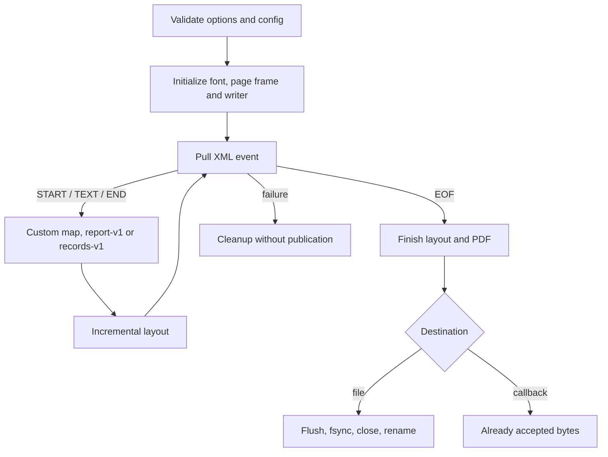

# Conversion pipeline
Active contributors: Artem

`src/convert.c` connects a byte source to a mapper, layout and PDF output. All six public conversion calls share `convert_streams`; their differences are configuration and whether the destination is a callback or an atomically replaced file.

## Boundaries and state

| Abstraction | Role |
| --- | --- |
| `KiOptions` / `KiConfig` | I/O, mapping and quotas / geometry and optional document information |
| `Setup` | Validated, call-owned copies of `Geometry` and `PdfInfo` |
| `ReadState` | File or callback input, cancellation and I/O failure flags |
| `KiDoc` | Opaque mapper handle to layout, current event position and mapper error |
| `ByteSink` | Callback output, accepted-byte count and first-write-error latch |
| `convert_streams` | Shared event loop, finishing, metrics and cleanup |

These are defined in `src/convert.c` and `include/ki_xml_pdf.h`. The subsystem is one C implementation unit with two focused C test files (`tests/test_callback_io.c`, `tests/test_integration.c`, 2:1), plus substantial shared tests in `tests/test_stream.c`.

## Entry routes and validation

| Original call | Configured call | Input → output |
| --- | --- | --- |
| `ki_convert_file` | `ki_convert_file_cfg` | Paths → atomic file; ignores I/O callbacks |
| `ki_convert_to_file` | `ki_convert_to_file_cfg` | Read callback → atomic file; ignores write callback |
| `ki_convert` | `ki_convert_cfg` | Read callback → write callback |

The original calls delegate with a NULL config. Every entry initializes a non-NULL result before validation. `reject_options` requires the exact options size, nonnegative quotas/selection and a known built-in profile, even when a custom mapper is supplied. `reject_config` accepts only the full config size or `KI_CONFIG_SIZE_GEOMETRY`, validates rounded geometry and copies optional metadata before opening files or invoking conversion callbacks (`src/convert.c`).

Font-dependent page fitting happens later in `pdf_begin_cfg`, before the first read, write or map callback. File entry points may already have opened input and a temporary output; cleanup still preserves the destination. This differs from static configuration rejection, which performs no file I/O. See [Geometry](geometry.md).

## Conversion flow

1. File routes reject identical input/output identity, open input when applicable, and create a temporary PDF beside the destination.
2. `convert_streams` initializes the fixed parser, then `pdf_begin_cfg` loads the font, fits geometry, opens the counted writer and emits font objects.
3. Each loop iteration checks cancellation, pulls `xml_next`, and exposes borrowed `KiEvent` pointers for the current event.
4. Dispatch order is custom `opt->map`, otherwise `report_map` for `KI_PROFILE_REPORT`, otherwise default `map_event`.
5. At EOF, `layout_finish` flushes the last page. Zero rendered pages is an `empty document` failure.
6. `pdf_end` completes the page tree, optional Info, xref and trailer. The driver flushes/frees the writer, then flushes, syncs, closes and renames file output.
7. Cleanup releases internal streams, font, buffers and spool, removes unpublished temporary output, and fills the result.

## Failures and positions

`fail_from_pdf` translates internal writer failures; `KiDoc` preserves explicit mapper, font and cluster failures (`src/convert.c`).

| Status | Causes | Typical source |
| --- | --- | --- |
| 1 | `KI_CAUSE_XML`, `KI_CAUSE_PROFILE`, `KI_CAUSE_FONT` | Invalid XML/schema, missing glyph or unreadable/mutated font |
| 2 | `KI_CAUSE_USAGE` | Options/config size, invalid geometry/metadata or no line/glyph fits |
| 3 | `KI_CAUSE_IO` | Read/write/publish failure, non-memory zlib error |
| 4 | `KI_CAUSE_RESOURCE`, `KI_CAUSE_CANCEL` | Quota, classic-xref ceiling, unsplittable glyph cluster, cancellation |

XML and profile messages end with `at line L, column C, byte B`. The driver stores each event's consumed position in `KiDoc`; `ki_doc_fail` appends it, shortening an oversized rule at a UTF-8 boundary. Public events expose the raw byte offset, not separate line/column fields. Other causes normally have no position; position-counter overflow is a positioned resource failure. See [XML parser](xml-parser.md).

Cancellation is polled before/after reads, between events, during PDF finishing about every 64 page/object entries, and around publication, including after fsync and close before rename. The library installs no signal handlers. Successful rename is the publication boundary and is not rolled back.

## Metrics and ownership

`KiResult` contains page/object counts, offset/spool bytes, output bytes and report counters. For callbacks, `ki_convert_cfg` replaces the writer's buffered accounting with `ByteSink.accepted` after all closing flushes. A valid positive short write counts its accepted prefix but fails conversion; later callback writes are forbidden by the latch. File failures do not publish those bytes. Failure metrics are diagnostic, not a complete-document guarantee.

The library closes streams it opens, never caller-owned callback resources. Separate conversion states may run concurrently. Legacy exports and fault-injection globals in `src/convert.h` remain compatibility/testing tools: `xml2pdf_convert_cap` applies its historical `page_cap` argument as an output-byte quota, not a page count.

## Change entry points

- Routes and validation: `reject_options`, `reject_config` and the public wrappers in `src/convert.c`. Keep the size-checked [C API](../api/c-api.md) and additive ABI exports consistent.
- Mapper selection/text rules: `convert_streams` and `map_event`; see [Custom mappers](../features/custom-mappers.md).
- Failure translation: `fail_from_pdf`, `ki_doc_text`, `ki_doc_fail`; do not replace an existing emission error with a schema error.
- Publication/cancellation: the finishing block and [Atomic output](../features/atomic-output.md). Test late failures as well as early rejection.

## Key source files

| File | Role |
| --- | --- |
| `src/convert.c`, `src/convert.h` | Public routes, event loop, cleanup and legacy/testing interfaces |
| `include/ki_xml_pdf.h` | Options, config, result, events and callback contracts |
| `src/report.c` | Built-in report mapper |
| `src/pdf_write.c` | Writer setup, finishing and resource failures |
| `tests/test_stream.c` | API, publication, selection and ownership regression groups |
| `tests/test_callback_io.c`, `tests/test_integration.c` | Latched callback failures and combined/reused contexts |

Related: [Streaming I/O](../features/streaming-io.md), [Resource limits](../features/resource-limits.md), [Testing](../how-to-contribute/testing.md).
