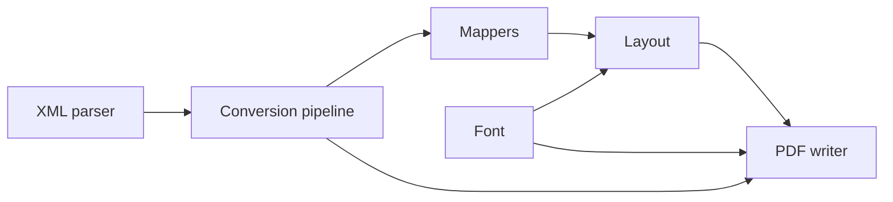

# Systems

The library in `src/` is a chain of small modules. Each one has a fixed-size state struct and a narrow C interface, and `src/convert.c` wires them together.

| System | Files | Summary |
| --- | --- | --- |
| [Conversion pipeline](conversion-pipeline.md) | `src/convert.c`, `src/convert.h` | Public entry points, the event loop, error mapping and atomic publication |
| [XML parser](xml-parser.md) | `src/xml_parse.c`, `src/xml_parse.h` | Bounded pull parser for a documented XML subset |
| [Layout and fonts](layout-and-fonts.md) | `src/layout.c`, `src/font.c` | UTF-8 decoding, glyph-width wrapping, TrueType metrics |
| [PDF writer](pdf-writer.md) | `src/pdf_write.c`, `src/pdf_write.h` | Append-only PDF with an embedded font and a disk-spooled xref |
| [Page sink](page-sink.md) | `src/page_sink.c`, `src/page_sink.h` | Older byte-grid page buffer, now exercised only by tests |

Mappers are described on the feature pages: [records-v1](../features/records-v1.md), [report-v1](../features/report-v1.md) and [Custom mappers](../features/custom-mappers.md). The CLI front end is on [CLI](../features/cli.md).
