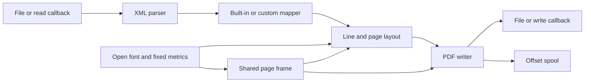

# Systems

The 0.3.0 library has eight C implementation units and one public header. `src/convert.c` connects the parser, a mapper, font-aware layout and the append-only writer; the CLI is a ninth C unit.

| System | Responsibility | Implementation units | Focused C test files |
| --- | --- | --- | --- |
| [Conversion pipeline](conversion-pipeline.md) | Validation, dispatch, ownership, errors and publication | 1 | 2 |
| [XML parser](xml-parser.md) | Bounded UTF-8 pull parsing and consumed positions | 1 | 2 |
| [Layout and fonts](layout-and-fonts.md) | Incremental word wrapping and TrueType metrics | 2 | 2 |
| [Geometry](geometry.md) | Shared rounded page geometry and glyph-ink fitting | 1 | 1 |
| [PDF writer](pdf-writer.md) | Flate streams, fixed page IDs and disk-spooled xref | 1 | 2 |

Counts describe files, not coverage percentages. Pipeline tests are `tests/test_callback_io.c` and `tests/test_integration.c`; parser tests are `tests/test_xml_subset.c` and `tests/test_xml_coords.c`; layout/font tests are `tests/test_layout_wrap.c` and `tests/test_font_metrics.c`; geometry uses `tests/test_geometry.c`; writer tests are `tests/test_pdf_bounds.c` and `tests/test_flate.c`. All share the harness and extra regression groups in `tests/test_stream.c`, and have Python/Poppler checks.

The other two library units are thin feature modules: `src/report.c` implements [report-v1](../features/report-v1.md), and `src/info.c` implements [document information](../features/document-information.md). `src/platform.h` enforces the Linux/glibc boundary. History on `origin/main` has one human contributor, Artem Klen (byline Artem), across these modules; this is historical ownership, not a formal CODEOWNERS assignment.

The removed byte-grid experiment is historical context in [Design decisions](../background/design-decisions.md), not a live subsystem. Start with [Architecture](../overview/architecture.md) for the whole flow or [Features](../features/index.md) for user-visible behavior.

## Key source files

| File | Role |
| --- | --- |
| `include/ki_xml_pdf.h` | Public C/C++ contract |
| `src/convert.c` | Pipeline composition |
| `Makefile`, `CMakeLists.txt` | Authoritative lists of library units and tests |
| `tests/test_stream.c` | Shared C regression harness |
