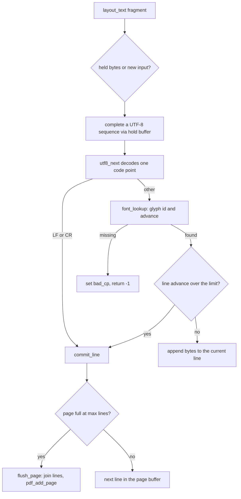

# Layout and fonts

Active contributors: Artem Klen

The layout engine in `src/layout.c` receives text fragments and breaks from a mapper and assembles pages of lines, wrapping at the measured width of the text rather than a column count. Widths come from `src/font.c`, a small TrueType reader that keeps just enough of DejaVu Sans to map and measure a fixed repertoire of code points. Baselines and line counts are computed from the font's ink, so glyphs stay inside the page margins.

## Purpose

Layout is the stage between the mappers and the PDF writer. A mapper emits arbitrary fragments through `ki_doc_text` and `ki_doc_break`; layout joins them into lines, wraps them by glyph advance, groups them into pages of at most 50 lines, and hands each finished page to `pdf_add_page`. The font module answers two questions for every code point: which glyph, and how wide. Both modules hold fixed tables and the font file bytes, nothing that grows with the document.

## Key abstractions

| Abstraction | Defined in | Role |
| --- | --- | --- |
| `Layout` | `src/layout.h` | Current line, up to 50 buffered lines, UTF-8 hold buffer, `bad_cp` |
| `layout_init` | `src/layout.c` | Bind a `Layout` to a `PdfWriter` |
| `layout_text` | `src/layout.c` | Append a fragment, decode, measure, wrap |
| `layout_break` | `src/layout.c` | Commit the current line if it has content |
| `layout_finish` | `src/layout.c` | Commit the last line and flush the last page |
| `commit_line`, `flush_page` | `src/layout.c` | Move a line into the page, move a page to the writer |
| `FontFace` | `src/font.h` | Font file bytes plus fixed glyph ID and advance tables |
| `font_load`, `font_free`, `font_lookup` | `src/font.c` | Load, release, constant-time lookup |
| `font_open_default` | `src/font.c` | Font search order |
| `font_first_baseline`, `font_max_lines` | `src/font.c` | Ink-based baseline and line count |
| `find_table`, `format4`, `glyph_of`, `advance_of` | `src/font.c` | TrueType reader internals |

## How it works

### Page geometry

The page is US Letter portrait, 612 by 792 points, with 40-point margins, 10-point type and 14-point leading. The constants live in two files: `PAGE_FONT_PT`, `PAGE_LEADING`, `PAGE_MARGIN`, `PAGE_WIDTH` and `PAGE_MAX_LINES` (50) at the top of `src/pdf_write.c`, and `LAYOUT_LINE` (1024) and `LAYOUT_LINES` (50) in `src/layout.h`. The page height 792 is a literal at the call sites, `commit_line` in `src/layout.c` and `pdf_add_page` in `src/pdf_write.c`. Text width is 612 - 80 = 532 points, and `line_limit` expresses that as glyph advances: `(612 - 80) * units / 10` in font units, which is 108,953 units for the bundled font with 2048 units per em.

### The TrueType reader

`font_load` reads the whole file into memory, rejecting anything smaller than 12 bytes or larger than 8 MiB (the bundled `fonts/DejaVuSans.ttf` is 759,720 bytes). It then requires four tables: `head` (at least 54 bytes), `cmap`, `hhea` (at least 36 bytes) and `hmtx`. From `head` it reads `unitsPerEm` at offset 18 and the bounding box at offsets 36 to 42; from `hhea` it reads ascent and descent at offsets 4 and 6 and `numberOfHMetrics` at offset 34. `find_table` walks the 16-byte table-directory records with bounds checks. `format4` picks the last subtable with platform 3, encoding 1, format 4. `glyph_of` runs the segment search over the endCode, startCode, idDelta and idRangeOffset arrays. `advance_of` reads a glyph's advance width from `hmtx`, using the last row when the glyph ID is at or past `numberOfHMetrics`. A font that does not map 'A' (0x41) or space (0x20) is rejected. The raw file bytes stay in `FontFace.ttf` because the PDF writer embeds them as FontFile2; `font_free` releases them.

### Repertoire

| Range | Constants | Covered |
| --- | --- | --- |
| U+0000 to U+04FF | `FONT_BMP_MAX` 0x500 in `src/font.h` | ASCII, Latin-1, Latin Extended, Greek, Cyrillic |
| U+2010 to U+2027 | `FONT_PUNCT_BASE` 0x2010, `FONT_PUNCT_COUNT` 24 in `src/font.h` | Dashes, quotes, bullets, ellipsis |

`remember` stores a glyph ID and advance pair only when both are non-zero. `font_lookup` is two array reads and returns -1 for anything outside the ranges or unmapped in the font. The bundled DejaVu Sans maps all 24 punctuation slots. A code point outside the repertoire is a font error, not an XML error; see `bad_cp` below.

### Font search order

`font_open_default` tries, in order:

1. `KI_XML_PDF_FONT` from the environment, when set and non-empty. This source is exclusive: if the load fails, the failure is returned and nothing else is tried.
2. `XML2PDF_FONT_PATH`, the path compiled in by the build. `Makefile` defines it as `$(PREFIX)/share/ki_xml_pdf/DejaVuSans.ttf`.
3. Three paths next to the running executable, resolved through `/proc/self/exe`: `fonts/DejaVuSans.ttf`, `../fonts/DejaVuSans.ttf`, `../share/ki_xml_pdf/DejaVuSans.ttf`. The build copies the font next to the binary for this.
4. `fonts/DejaVuSans.ttf` in the current working directory.

The `/proc/self/exe` lookup is one of the Linux-only assumptions in the project. `KiOptions.font_path` bypasses the search; it reaches `font_load` through `pdf_begin_cfg` in `src/pdf_write.c`.

### Measuring, wrapping and the hold buffer

`layout_text` decodes one code point at a time. `seq_need` sizes a sequence from its lead byte (1 to 4 bytes); when a fragment ends mid-sequence, the bytes are parked in the 4-byte hold buffer and the call returns 0, waiting for the next fragment to complete the character. `layout_finish` fails if a sequence never completes. Decoding rejects malformed input: bad lead bytes, truncated sequences, overlong forms and values above U+10FFFF (`utf8_next` in `src/layout.c`).

For each decoded code point, tab is measured as space, LF and CR commit the current line, and everything else goes through `font_lookup`. Wrapping happens before appending: when the line already has content and the accumulated advance plus the next glyph would exceed `line_limit`, `commit_line` runs first. A single glyph wider than the limit, or a line at `LAYOUT_LINE` bytes, is an error. `layout_break` commits only a non-empty line, so consecutive breaks never produce blank lines.

### Lines and pages

`commit_line` asks `font_max_lines(792, 40, 10, 14)`, clamps the result into the range 1 to 50, and calls `flush_page` when the page buffer is full. `flush_page` joins the buffered lines with `\n` into one heap buffer, hands it to `pdf_add_page`, frees it and resets the count. A page with no lines produces no PDF page. The heap buffer exists only for the duration of one `pdf_add_page` call, which is what keeps the stage's footprint fixed.

### Ink-based baseline and line count

`ink_ascent` is the larger of the positive `hhea` ascent and the `head` bounding box top, falling back to units per em; `ink_descent` is the larger of the negated `hhea` descent and the bounding box bottom. At 10 points these become integer point values through `value * pt / units`. `font_first_baseline` returns page height minus margin minus ascent, never above the margin; `font_max_lines` returns `(baseline - (margin + descent)) / leading + 1`, or 1 when the leading cannot fit.

For the bundled DejaVu Sans (2048 units per em, ascent 1901, descent -483, bounding box y from -948 to 2524), the ink ascent is 12 points and the ink descent is 4 points. The first baseline lands at 740, and `(740 - 44) / 14 + 1` is 50 lines per page, exactly the `LAYOUT_LINES` and `PAGE_MAX_LINES` caps.

### bad_cp

When `font_lookup` fails, `layout_text` records the code point in `Layout.bad_cp` and returns -1. `ki_doc_text` in `src/convert.c` turns that into cause `KI_CAUSE_FONT` with a "font: U+%04X" message. Per `include/ki_xml_pdf.h`, a character outside the repertoire is a font cause, not an XML syntax error. The writer re-validates every line with `line_too_wide` in `src/pdf_write.c` before it goes into a page.

## Integration points

- The public document calls `ki_doc_text` and `ki_doc_break` in `src/convert.c` wrap `layout_text` and `layout_break`; see [C API](../api/c-api.md).
- The built-in mappers emit through those calls for every record and field: [records-v1](../features/records-v1.md), [report-v1](../features/report-v1.md), [custom mappers](../features/custom-mappers.md).
- `layout_init` binds a `Layout` to a `PdfWriter`, and `flush_page` is the only caller of `pdf_add_page`; see [PDF writer](pdf-writer.md).
- Geometry constants are shared with the writer, so a page-size change touches both `src/layout.c` and `src/pdf_write.c`.
- What happens when a quota trips during a page write is described in [Resource limits](../features/resource-limits.md).
- Pipeline-level tests that exercise layout and fonts live in `tests/test_stream.c`; see [Testing](../how-to-contribute/testing.md).

## Entry points for modification

- Repertoire: `FONT_BMP_MAX` and the `FONT_PUNCT_*` constants in `src/font.h`, plus `remember` in `src/font.c`. The `/W` widths and the ToUnicode CMap in `src/pdf_write.c` enumerate the same tables, so all three move together.
- Page geometry: `PAGE_*` in `src/pdf_write.c`, `LAYOUT_LINE` and `LAYOUT_LINES` in `src/layout.h`, and the 612 and 792 literals at the call sites.
- Wrapping policy (wrap, break long runs, or fail): the width checks in `layout_text` in `src/layout.c`.
- Baseline and line-count math: `ink_ascent`, `ink_descent`, `font_first_baseline`, `font_max_lines` in `src/font.c`.
- Font sources: `font_open_default` in `src/font.c`, plus the install layout in `Makefile` and `CMakeLists.txt`.

## Key source files

| File | Role |
| --- | --- |
| `src/layout.c` | Line assembly, wrapping, page emission |
| `src/layout.h` | `Layout` struct, line and page bounds |
| `src/font.c` | TrueType reader, search order, ink metrics |
| `src/font.h` | `FontFace` struct, repertoire constants |
| `src/pdf_write.c` | Shared page geometry constants, line re-validation, font embedding |
| `fonts/DejaVuSans.ttf` | The bundled font (759,720 bytes) |
| `tests/test_stream.c` | End-to-end tests covering layout and fonts |
