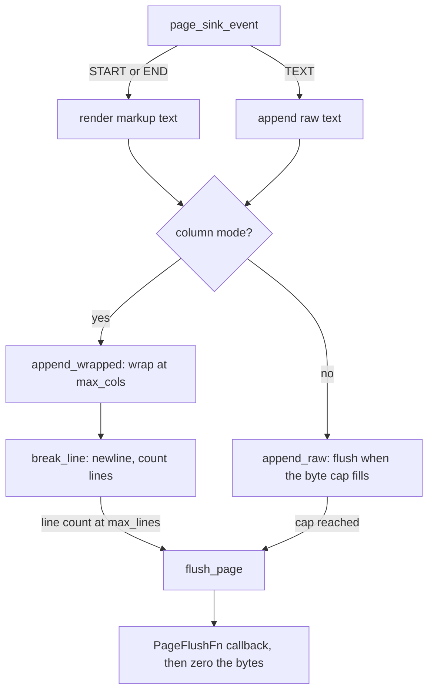

# Page sink

Active contributors: Artem Klen

Removed. `src/page_sink.c`, `src/page_sink.h` and `test_page_sink_flushes` are not in the tree. Dynamic `nm -D` did not list `page_sink` symbols, which matches `local: *` in `libki_xml_pdf.map`. `XML2PDF_PAGE_COLS`, `XML2PDF_PAGE_LINES` and `XML2PDF_PAGE_CAP` in `src/convert.h` stay, because `tests/test_stream.c` still uses the cap. The rest of this page describes the module as it was: a fixed byte-grid page buffer.

## Purpose

The shipped pipeline renders documents through the layout engine with measured DejaVu Sans glyph widths ([Layout and fonts](layout-and-fonts.md)) and writes real PDF pages ([PDF writer](pdf-writer.md)). The page sink implemented a simpler model: a page is a grid of columns and lines counted in bytes, and the job was to flush full buffers. The sizing comment in `src/convert.h` still describes that grid as "a letter page in Helvetica 10pt", while the current code embeds DejaVu Sans and measures advances instead of counting columns.

## Key abstractions

| Abstraction | Defined in | Role |
| --- | --- | --- |
| `PageSink` | `src/page_sink.h` | Buffer, column and line counters, flush callback |
| `PageFlushFn` | `src/page_sink.h` | Receives one finished page; the bytes are valid only during the call |
| `page_sink_init`, `page_sink_free` | `src/page_sink.c` | Allocate the buffer zeroed; release it |
| `page_sink_set_columns` | `src/page_sink.c` | Turn on column and line wrapping (both values must be positive) |
| `page_sink_event`, `page_sink_finish` | `src/page_sink.c` | Feed one event; flush the remainder |
| `append_raw`, `append_wrapped`, `break_line`, `flush_page` | `src/page_sink.c` | Buffer mechanics |
| `XML2PDF_PAGE_COLS`, `XML2PDF_PAGE_LINES`, `XML2PDF_PAGE_CAP` | `src/convert.h` | The historical grid: 90 columns, 48 lines, 48 * 91 = 4368 bytes |

## How it works

- Rendering: a START event becomes `<name a="v">\n`, an END event becomes `</name>\n`, TEXT is appended raw, and every other event kind is ignored. This reconstructs XML-like text from events, the opposite direction of the shipped mappers, which turn events into document text.
- Two modes. Without `page_sink_set_columns`, `append_raw` applies the byte cap only, and newlines are ordinary bytes; the page boundary is the cap. With columns set, `append_wrapped` also wraps at `max_cols` and flushes at `max_lines`.
- `append_raw` keeps a piece that fits in an empty page intact, flushing the current page first if needed; a piece larger than the page is split, as its comment states.
- `append_wrapped` wraps runs between newlines at the column limit. A short run that does not fit the remaining columns moves to a new line first; a run longer than the whole line is split, because it cannot fit even on an empty line.
- `break_line` appends the newline, resets the column counter, counts the line and flushes when the count reaches `max_lines`.
- `flush_page` invokes the callback with the buffer, then zeroes exactly the delivered bytes before returning. The header states the contract: the bytes are valid only for the duration of the call, so a consumer that wants to keep them must copy, and the cleared buffer is observable through `page_sink_pending` and `page_sink_pending_data`.
- `page_sink_finish` flushes whatever is pending, possibly nothing.

## Where it was used

- Build wiring, before removal: `src/page_sink.c` was in `CMakeLists.txt` (`KI_CORE_SOURCES`) and `Makefile` (`LIB_SRCS`).
- The only caller was `test_page_sink_flushes` in `tests/test_stream.c`. It ran in byte-cap mode with a 48-byte page, fed an early marker, 100 `X` characters and a late marker, and asserted at least two pages, the early marker on the first page, the late marker not on it, zero pending bytes after `page_sink_finish`, and a fully zeroed buffer afterwards.
- The header was internal (`src/page_sink.h`); nothing in `include/ki_xml_pdf.h` exposed it.
- The `XML2PDF_PAGE_*` constants survive in two places: `tests/test_stream.c` uses `XML2PDF_PAGE_CAP` to size synthetic inputs (`test_convert_pipeline` and the mismatched end-tag case), and `xml2pdf_convert_cap` in `src/convert.h` keeps the old "page cap" wording while mapping its argument onto `KiOptions.max_output_bytes` in `src/convert.c`, so today it caps output bytes, not pages.

## Integration points

- It consumes `XmlEvent` straight from the parser ([XML parser](xml-parser.md)). In the shipped pipeline that consumer role belongs to the mappers: [records-v1](../features/records-v1.md), [report-v1](../features/report-v1.md), [custom mappers](../features/custom-mappers.md).
- Nothing in the driver or CLI reaches it; the pipeline wiring is described in [Conversion pipeline](conversion-pipeline.md).
- The removal is recorded in [Cleanup opportunities](../cleanup-opportunities.md).

## Entry points for modification

- The sources are already gone. `XML2PDF_PAGE_*` and `xml2pdf_convert_cap` in `src/convert.h` were left in place: tests still size inputs with `XML2PDF_PAGE_CAP`, and `xml2pdf_convert_cap` is an exported `KI_0_1` symbol.
- Reviving a byte grid would be a new module. These notes are the contract that module used.

## Key source files

| File | Role |
| --- | --- |
| `src/convert.h` | `XML2PDF_PAGE_*` grid constants, `xml2pdf_convert_cap` |
| `tests/test_stream.c` | Still uses `XML2PDF_PAGE_CAP`; the sink test is gone |
