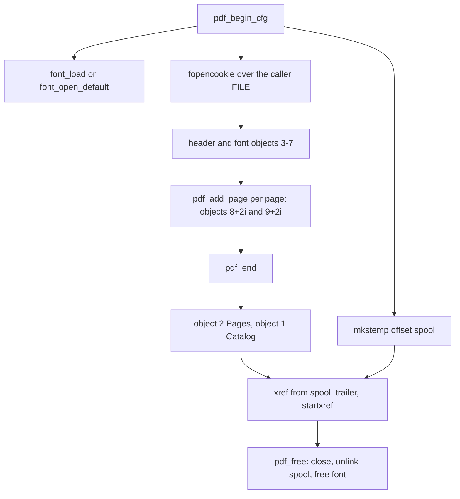

# PDF writer

Active contributors: Artem Klen

`src/pdf_write.c` produces the output PDF as an append-only byte stream. Object numbers are a fixed function of the page index, each object's byte offset is spooled to a temp file at 8 bytes per object, and the cross-reference table is written at the end, so nothing grows in RAM as pages accumulate. Page count, output size, spool size and cancellation are enforced inside the writer.

## Purpose

The writer owns everything that is PDF-specific: the header, the embedded CID font, one content stream per page, the page tree, the xref and the trailer. Its design constraint is the same as the rest of the pipeline: a page is rendered, written and dropped before `pdf_add_page` returns, and the only per-object memory is one row in a disk file. The driver around it handles publication (temp file, fsync, rename); the writer only appends bytes to the stream it is given.

## Key abstractions

| Abstraction | Defined in | Role |
| --- | --- | --- |
| `PdfConfig` | `src/pdf_write.h` | Font path, temp dir, quotas, cancellation, fault injection |
| `PdfWriter` | `src/pdf_write.h` | Writer state; failures land in `fail_kind`, `fail_errno`, `hit_limit` |
| `pdf_begin`, `pdf_begin_cfg` | `src/pdf_write.c` | Spool setup, font load, cookie layer, header, font objects |
| `pdf_add_page` | `src/pdf_write.c` | Render one page of lines as two objects |
| `pdf_end` | `src/pdf_write.c` | Pages and Catalog objects, xref, trailer |
| `pdf_free` | `src/pdf_write.c` | Close, unlink the spool, free the font |
| `note_offset`, `begin_obj` | `src/pdf_write.c` | Object plumbing |
| `cap_write` | `src/pdf_write.c` | fopencookie layer that counts and caps bytes |
| `pdf_live_page_bytes`, `pdf_page_count`, `pdf_object_count`, `pdf_hit_object_limit` | `src/pdf_write.h` | Observation hooks for tests |

## How it works

### Fixed object numbering

| Constant | Number | Written |
| --- | --- | --- |
| `OBJ_CATALOG` | 1 | In `pdf_end` (references the Pages tree) |
| `OBJ_PAGES` | 2 | In `pdf_end` (needs the final page count) |
| `OBJ_TYPE0` | 3 | In `pdf_begin_cfg` via `write_font_objects` |
| `OBJ_CID` | 4 | In `pdf_begin_cfg` |
| `OBJ_DESC` | 5 | In `pdf_begin_cfg` |
| `OBJ_FILE` | 6 | In `pdf_begin_cfg` |
| `OBJ_CMAP` | 7 | In `pdf_begin_cfg` |
| `OBJ_FIRST` | 8 | First content stream |

Page `i` owns content stream `OBJ_FIRST + 2*i` and page object `OBJ_FIRST + 2*i + 1`. The writer never stores page object numbers; it recomputes them from the index, and `nobj` only tracks the highest number seen. Numbering is dense, so the xref has no holes, and a document with zero pages still has the seven font and catalog objects with a valid xref. `MAX_OBJECTS` (8,000,000) bounds object numbers in `note_offset`, which bounds a document at 3,999,996 pages.

### Byte counting and the cookie layer

`pdf_begin_cfg` never writes to the caller's `FILE *` directly. It wraps it in an `fopencookie` stream (`PdfCap` plus `cap_write`): each write passes straight to the raw file while `PdfWriter.written` accumulates. `max_output` is enforced here; a write that would cross the cap fails with `EFBIG`, sets `fail_kind` 4 and `hit_limit`. `cap_close` frees the cookie, and `pdf_free` closes the cookie stream but never the caller's file (the `w->fp != w->raw` check).

### The offset spool

Object offsets live in a temp file created with `mkstemp` in `cfg->temp_dir` (default `/tmp`), pattern `ki-xml-pdf-off-XXXXXX`, opened `w+b`. `note_offset` flushes the cookie stream first so `written` is the true byte position, then writes that position, a `long`, at file offset `num * 8`. The spool quota is `(num + 1) * 8` bytes against `max_spool`; the default is 64 MiB when the option is unset, and `MAX_OBJECTS` times 8 is about 61 MiB, so with defaults the object cap trips before the spool cap. `pdf_end` fstat's the spool into `spool_bytes`. `pdf_free` closes and unlinks it.

### Font objects

`write_font_objects` emits, in order:

- Object 6: FontFile2, the raw TrueType bytes as a stream.
- Object 5: FontDescriptor for `/DejaVuSans`, flags 32, FontBBox, Ascent, Descent and CapHeight scaled by 1000/units per em (`pdf_scale`), StemV 80.
- Object 4: CIDFontType2 with Adobe-Identity CIDSystemInfo, `CIDToGIDMap /Identity`, default width 500, and a `/W` array built by `write_widths` from the same repertoire tables the layout stage uses.
- The ToUnicode CMap stream from `write_tounicode`: codespace `<0000> <FFFF>` and `beginbfchar` groups of at most 100 entries, each mapping a glyph ID to its Unicode value. The body is counted, then written with a direct `/Length`. It is not kept in a heap buffer and it is not Flate.
- Object 3: Type0 font with `Identity-H` encoding pointing at objects 4 and 7.

### Page content

`pdf_add_page` renders one page of newline-separated lines into a 256 KiB heap buffer: `BT`, `/F1 10 Tf`, `14 TL`, then `40 <baseline> Td` with the baseline from `font_first_baseline(font, 792, 40, 10)`. Each line after the first gets `T*`. Each line is wrapped in a marked-content span with `/ActualText` (the line's text as UTF-16BE with a FEFF BOM, surrogate pairs for astral code points), followed by the visible text, a hex string of glyph IDs and `Tj`, then `EMC`. The ActualText span exists because Poppler's layout extractor drops a space whose gap equals the glyph advance, as the comment on `append_actual_text` explains. An empty page emits `<> Tj`. The stream ends with `ET`.

Before writing, `line_too_wide` re-measures each line with `font_lookup` against `(612 - 80) * units / 10`, so an unmapped code point or an over-wide line fails the page even if layout let it through. Lines per page come from `font_max_lines(font, 792, 40, 10, 14)`, capped by `PAGE_MAX_LINES` (50). The page object itself is `/Type /Page`, parent object 2, `MediaBox [0 0 612 792]`, contents the stream object, resources `/Font /F1 3 0 R`.

`live_page_bytes` is set while the stream is built and cleared once the objects are written, so `pdf_live_page_bytes` returns 0 between pages. Tests assert this to show each page is released.

### xref and trailer

`pdf_end` writes object 2, `/Pages` with `/Count` and a `/Kids` list of page object numbers (a newline every 8 entries), then object 1, `/Catalog` pointing at it. It flushes the spool and the cookie, records `xref_off = written`, writes `xref`, the entry count, the free entry, then one entry per object, each read back from the spool as `%010ld 00000 n`. An object number in 1..nobj with no positive offset fails `pdf_end`, which is why every object the numbering promises must actually be written. The trailer carries `/Size` and `/Root 1 0 R`, then `startxref` and `%%EOF`.

### Quotas

| Quota | Config field | Public option | Enforced in | Effect |
| --- | --- | --- | --- | --- |
| Object numbers | `MAX_OBJECTS` | none | `note_offset` | `fail_kind` 1, `hit_limit` |
| Page count | `max_pages` | `KiOptions.max_pages` | `pdf_add_page` | `fail_kind` 1, `hit_limit` |
| Output bytes | `max_output` | `KiOptions.max_output_bytes` | `cap_write` | `fail_kind` 4, `EFBIG`, `hit_limit` |
| Spool bytes | `max_spool` | `KiOptions.max_spool_bytes` | `note_offset` | `fail_kind` 5, `hit_limit`; default 64 MiB |

The counters surface in `KiResult` through the driver: `pdf_page_count` becomes `pages`, `pdf_object_count` becomes `objects`, `written` becomes `output_bytes`, and `spool_bytes` becomes `spool_bytes` (and `offset_bytes`), all copied in `src/convert.c`.

### fail_kind

| Value | Meaning | Set by |
| --- | --- | --- |
| 0 | No specific kind | The header write, the `line_too_wide` re-check in `pdf_add_page`, and generic write failures in `pdf_end` |
| 1 | Limit reached, or the spool path allocation failed | `note_offset` (object number), `pdf_add_page` (pages), `pdf_begin_cfg` malloc |
| 2 | I/O error or injected failure | `fflush`/`fwrite` failures, `mkstemp`/`fdopen`/`fopencookie` failures, temp path too long (`fail_errno` = `ENAMETOOLONG`), `debug_fail_page`, the fallback after `write_font_objects` |
| 3 | Font load failed | `pdf_begin_cfg` |
| 4 | Output byte quota | `cap_write` |
| 5 | Spool byte quota | `note_offset` |
| 6 | Cancelled | `stop_pdf` |

`fail_from_pdf` in `src/convert.c` maps these to the public status and cause: 6 becomes `XML2PDF_ERR_RESOURCE` with `KI_CAUSE_CANCEL`, 3 becomes `XML2PDF_ERR_XML` with `KI_CAUSE_FONT`, 1, 4, 5 or any `hit_limit` becomes `XML2PDF_ERR_RESOURCE` with `KI_CAUSE_RESOURCE`, and the rest become `XML2PDF_ERR_IO` with `KI_CAUSE_IO`. The full table is in [Conversion pipeline](conversion-pipeline.md).

### Cancellation

`stop_pdf` polls `cancelled(cancel_user)` and sets `fail_kind` 6. Polling happens in `pdf_end` only: at entry, every 64 `/Kids` entries, and every 64 xref entries. There is no poll inside `pdf_add_page`; during document growth the driver's own per-event poll bounds the latency, as described in [Conversion pipeline](conversion-pipeline.md).

### Debug hooks

- `PdfConfig.debug_fail_page` makes the nth `pdf_add_page` fail before writing anything (`fail_kind` 2). `xml2pdf_debug_fail_at_page` in `src/convert.c` feeds it, and the driver clears the hooks when a conversion returns.
- `pdf_debug_fail_at_page` in `src/pdf_write.c` is a no-op stub that discards its argument. The header still documents the intent, but the working knob is the config field.
- The observation hooks (`pdf_live_page_bytes`, `pdf_page_count`, `pdf_object_count`, `pdf_hit_object_limit`) exist for tests.

## Integration points

- `convert_streams` in `src/convert.c` fills `PdfConfig` from `KiOptions` (`font_path`, `temp_dir`, `max_pages`, `max_output_bytes`, `max_spool_bytes`, `cancelled`, `debug_fail_page`) and maps failures through `fail_from_pdf`. See [Conversion pipeline](conversion-pipeline.md) and [C API](../api/c-api.md).
- `flush_page` in `src/layout.c` is the only caller of `pdf_add_page`; see [Layout and fonts](layout-and-fonts.md).
- The writer appends to a stream; the temp file, fsync and rename lifecycle is the driver's. See [Atomic output](../features/atomic-output.md) and [Streaming I/O](../features/streaming-io.md).
- Quota defaults and the RSS gate are described in [Resource limits](../features/resource-limits.md).
- An empty document (zero pages) is valid to the writer but rejected by the driver with "empty document".
- Writer tests, including the failure-path tests that use the debug hooks, live in `tests/test_stream.c` (`pdf_appends_and_releases`, `output_keeps_previous`, `convert_pipeline`); see [Testing](../how-to-contribute/testing.md).

## Entry points for modification

- Page appearance: the content stream built in `pdf_add_page` and the `PAGE_*` constants at the top of `src/pdf_write.c`.
- Font embedding: `write_font_objects`, `write_widths`, `write_tounicode`, and the `OBJ_*` numbering. Repertoire changes in `src/font.h` must be mirrored here.
- A new quota: a `PdfConfig` field, an enforcement point (`note_offset`, `cap_write` or `pdf_add_page`), a `fail_kind` value, and a row in `fail_from_pdf` in `src/convert.c`.
- Cancellation cadence: the `stop_pdf` call sites in `pdf_end`.
- xref or trailer changes: `pdf_end`. Every object number in 1..nobj must have a spooled offset or `pdf_end` fails.

## Key source files

| File | Role |
| --- | --- |
| `src/pdf_write.c` | Writer implementation |
| `src/pdf_write.h` | Config, writer struct, entry points |
| `src/font.c`, `src/font.h` | `FontFace` the writer embeds and measures with |
| `src/convert.c` | `PdfConfig` wiring and the `fail_kind` to status mapping |
| `tests/test_stream.c` | Writer, quota and failure-path tests |
