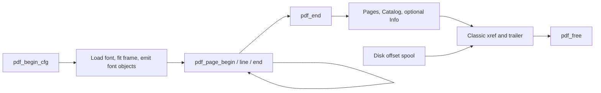

# PDF writer
Active contributors: Artem

`src/pdf_write.c` appends PDF 1.4 bytes without seeking the destination. It reuses bounded page/compression state, computes page object IDs rather than storing them, and keeps xref offsets in a temporary disk file.

## State and lifecycle

`PdfConfig` supplies font, geometry, optional `PdfInfo`, quotas and cancellation. `PdfWriter` owns the open font, offset spool, counted cookie stream, one reusable zlib state/output window and one reusable page-content buffer (`src/pdf_write.h`).

One C implementation unit has two focused C test files, `tests/test_pdf_bounds.c` and `tests/test_flate.c` (2:1), plus shared writer/buffer tests in `tests/test_stream.c` and independent Python checks.

## Object numbering

The constants in `src/pdf_write.c` define a dense object space, although physical write order differs from numeric order.

| ID | Object |
| --- | --- |
| 1 | Catalog, written at finish |
| 2 | Pages, written at finish |
| 3 / 4 / 5 | Type0 font / CIDFontType2 / FontDescriptor |
| 6 / 7 | Flate FontFile2 stream / its compressed length |
| 8 | Uncompressed ToUnicode CMap |
| `9 + 3*i` | Page `i` content stream, zero-based |
| `10 + 3*i` | Its compressed length |
| `11 + 3*i` | Page dictionary |

An ordinary finished PDF with `P` pages has `8 + 3*P` objects; nonempty `/Info` adds one final object. Page-tree `/Kids` entries are recomputed from this formula. Object numbers must be below 8,000,000; do not reuse the historical two-objects-per-page formula.

## Font streams and ToUnicode

`write_font_objects` rechecks the retained font file's size/FNV hash, then streams it into Flate in 16 KiB reads. `/Length1` is the original font size. Font descriptors use the parsed/fallback PostScript name with PDF-name escaping; `/W` uses the same truncated advances as geometry. The full TTF is embedded, not subsetted.

`write_tounicode` calls `tounicode_body` twice: first with no output to count bytes, then directly into the writer. It writes a direct `/Length`, with no heap CMap or heap seen bitmap. Fixed stack arrays deduplicate GIDs, retaining the first/lowest code point encountered, and emit `beginbfchar` groups of at most 100. The CMap stays uncompressed.

## One page buffer for the conversion

Layout sends its fixed lines through `pdf_page_begin`, `pdf_page_line`, `pdf_page_end`. `pdf_add_page` remains an internal convenience wrapper for newline-separated text, chiefly used by tests.

`ensure_page_buf` lazily allocates `256 + 50 * (8 * 1024 + 128) = 416256` bytes once. A new page resets cursors and overwrites that buffer; `pdf_free` releases it once. There is no joined-page heap copy and no allocation per page.

Each line is remeasured with `InkRun`/`geom_fits`, placed with the shared rounded baseline/shift, and written as:

- A marked-content `/ActualText` UTF-16BE hex string, preserving logical text and significant whitespace.
- A hex string of glyph IDs and `Tj` for visible text. Trailing spaces beyond the margin are omitted from this glyph string.

`pdf_page_end` Flate-compresses the buffered content, writes its length object and Page dictionary, and clears `live_page_bytes`. A zero live-byte count means no page is being emitted; it does **not** mean the reusable allocation was freed.

## Compression, counting and the spool

`flate_ready` initializes zlib once and uses `deflateReset` for later page/font streams. The output window is 16 KiB with an allocated safety pad. Each compressed stream refers to a following indirect length object, so its final length requires neither a seek nor a whole compressed-stream buffer.

The `PdfCap` cookie wraps the destination. `account_bytes` rejects a chunk whole before forwarding if it would exceed a user quota or the hard classic-xref ceiling, 9,999,999,999 total bytes. It counts the header, streams, metadata, xref and trailer too. Exact-size quotas succeed; one byte less fails.

`note_offset` flushes counted output, then writes one `long` at `object_number * 8` in the spool. A 64-bit Linux environment is assumed. The spool is created with `mkstemp` under `temp_dir` or `/tmp`; zero spool quota selects a 64 MiB default, not unlimited space.

`pdf_end` writes Pages/Catalog, optional Info, then reads each offset back to emit `%010ld` xref rows. Every numbered object needs a positive recorded offset. It appends the trailer, `startxref`, EOF and flushes. Cancellation is checked at entry and about every 64 page/object entries.

## Failure and ownership boundaries

`PDF_FAIL_*` distinguishes page/object/resource limits, I/O, font mutation/load, output/spool quota, cancellation, xref ceiling, zlib and geometry failures. `fail_from_pdf` in `src/convert.c` maps these to public status/cause. `Z_MEM_ERROR` is resource exhaustion; other zlib errors are I/O/compression failure.

`pdf_free` releases the font, compression/page allocations, cookie stream and spool, but not the caller's raw `FILE *`. The driver owns file publication and callback accepted-byte accounting. A callback's first error is latched in `src/convert.c`; buffered stdio must never turn a failed write into success.

## Change entry points

- Object graph: `OBJ_*`, `PAGE_OBJS`, `pdf_page_end`, `pdf_end`; update IDs, `/Kids`, optional Info and xref expectations together.
- Page syntax/bounds: `pdf_page_line`, `append_actual_text`, `append_hex_line`, `ensure_page_buf`.
- Memory lifecycle: preserve one `page_buf`, one compressor and no retained prior-page data.
- Quotas/accounting: `account_bytes`, `cap_write`, `note_offset`; test final trailer/metadata bytes and callback failures, not just page payloads.
- Font mapping: `write_widths`, `tounicode_body`; keep repertoire changes synchronized with `src/font.h`.

## Key source files

| File | Role |
| --- | --- |
| `src/pdf_write.c`, `src/pdf_write.h` | Writer, objects, buffers, compression, spool and bounds |
| `src/font.c`, `src/font.h` | Open-file metrics and pre-embed check |
| `src/geometry.c`, `src/info.c` | Shared placement and optional Info serialization |
| `tests/test_pdf_bounds.c`, `tests/test_flate.c` | Ceilings, exact quotas and zlib failure controls |
| `tests/test_stream.c` | Appending, page isolation and one-allocation assertions |
| `tests/pdf_offsets.py`, `tests/pdf_streams.py` | Independent xref/stream-length/inflate checks |

Related: [Layout and fonts](layout-and-fonts.md), [Document information](../features/document-information.md), [Atomic output](../features/atomic-output.md), [Resource limits](../features/resource-limits.md).
