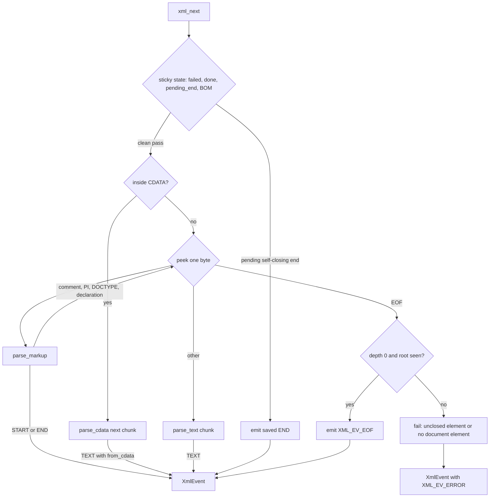

# XML parser

Active contributors: Artem Klen

`src/xml_parse.c` is a pull parser that turns a byte stream into `XmlEvent` records: start tag, end tag, text, EOF or error. It runs in fixed memory, a 4096-byte input window plus a 64-entry stack of open element names, with no allocation anywhere in the file. It accepts a documented subset of XML and rejects everything else with a message and a byte offset.

## Purpose

The parser is the first stage of the pipeline in [Architecture](../overview/architecture.md). Its job is to hand the driver one event at a time while keeping memory independent of document size, so a 1 GiB input costs the same as a 1 KiB one. The design is a single forward pass: no tree, no attribute map, no entity table, and a sticky error state instead of recovery.

## Key abstractions

| Abstraction | Defined in | Role |
| --- | --- | --- |
| `XmlParser` | `src/xml_parse.h` | All parser state: window, open-element stack, byte offset, error slot |
| `XmlEvent` | `src/xml_parse.h` | One START, END, TEXT, EOF or ERROR record |
| `XmlReadFn` | `src/xml_parse.h` | Byte source contract: count, 0 on EOF, negative on error |
| `xml_parser_init` | `src/xml_parse.c` | Construct from a read callback |
| `xml_parser_init_file` | `src/xml_parse.c` | Construct from a `FILE *` through `file_read` |
| `xml_next` | `src/xml_parse.c` | Pull the next event |
| `fill`, `peek`, `nextch` | `src/xml_parse.c` | Window refill and UTF-8 validation |
| `parse_markup`, `parse_text`, `parse_cdata` | `src/xml_parse.c` | The dispatch targets of `xml_next` |
| `try_entity`, `try_named`, `try_numeric` | `src/xml_parse.c` | Entity and character reference decoding |

## How it works

### Fixed bounds

The bounds are compile-time constants in `src/xml_parse.h`. Nothing grows with the document, so `sizeof(XmlParser)` is about 8 KiB (4 KiB window plus 4 KiB name stack plus small fields).

| Constant | Value | Meaning |
| --- | --- | --- |
| `XML_BUF_SIZE` | 4096 | Input window in bytes |
| `XML_NAME_MAX` | 64 | Element and attribute names up to 63 bytes |
| `XML_MAX_DEPTH` | 64 | Open elements at once |
| `XML_ATTR_MAX` | 8 | Attributes per start tag |
| `XML_ATTR_VAL_MAX` | 256 | Attribute values up to 255 bytes |
| `XML_TEXT_MAX` | 1024 | Text chunks up to 1023 bytes |
| `XmlParser.errmsg`, `XmlEvent.error` | 160 bytes each | Message buffers |

### The read contract

`XmlReadFn` in `src/xml_parse.h` reads up to `max` bytes into `dst` and returns the count, 0 on EOF, or a negative value on error. A short read is not EOF; the parser asks again. `fill` moves unread bytes to the front of the window with `memmove` so a token that straddles a refill stays contiguous, then asks the source for the remaining space. Decisions that need several bytes at once go through helpers that keep calling `fill`: `match_at` for fixed marks such as `<!DOCTYPE` and `[CDATA[`, `try_entity` and `try_named` for entity names, and `try_numeric` for reference digits. `]]>` is handled without look-ahead: CDATA holds back up to two `]` bytes in `cdata_mark`, and plain text counts them in `bracket_run`. A source that returns one byte at a time works; `one_byte_entities_and_nesting` in `tests/test_stream.c` feeds one-byte reads.

### Dispatch

`xml_next` resets the event fields, then works through sticky state: a recorded failure returns `XML_EV_ERROR` with the stored message, a completed document returns `XML_EV_EOF`, and a pending end tag left by a self-closing element is emitted before any new scanning. The first call consumes a BOM. The loop continues an open CDATA section while one exists, peeks one byte, and sends `<` to `parse_markup` and anything else to `parse_text`. Skipped markup (comment, PI, DOCTYPE) returns `XML_EV_NONE` internally and the loop runs again.

### The accepted subset

| Construct | Behavior | Code |
| --- | --- | --- |
| UTF-8 BOM | Consumed once, counted in the byte offset | `consume_bom` |
| XML declaration | First markup only; `version="1.0"` required; `encoding` only `utf-8`/`UTF-8`; `standalone` yes/no; unknown keys rejected | `xml_decl_ok` |
| Comments | Skipped; no `--` inside; must end with `-->` | `skip_comment` |
| Processing instructions | Skipped; body up to 255 bytes; the target that spells `xml` in the exact case is reserved for the declaration | `parse_markup` |
| DOCTYPE | At most one, at top level before the root; skipped whole, including quoted strings and a bracketed internal subset; external entities never fetched | `skip_bang`, `skip_decl_rest` |
| CDATA | Only inside element content; emitted as TEXT events with `from_cdata = 1` in chunks up to 1023 bytes | `parse_cdata` |
| Elements | One document element; matching end tags; self-closing tags emit START then END on the next call | `parse_start`, `parse_end`, `pop_name` |
| Attributes | Quoted; entities decoded; tab, LF and CR become spaces; up to 8, duplicates rejected, space required between them | `read_quoted`, `parse_start` |
| Text | Chunks up to 1023 bytes; whitespace-only outside the root | `parse_text` |
| Entities | `amp`, `lt`, `gt`, `quot`, `apos`, and decimal or hex numeric references | `try_named`, `try_numeric` |

### Encoding and validation

Only UTF-8 is supported. `consume_bom` skips `EF BB BF` and rejects the UTF-16 byte-order marks with "unsupported encoding". `feed_utf8` sees every byte through `nextch` and `note_bytes` and rejects NUL, lead bytes 0x80 to 0xC1 and 0xF5 to 0xFF, overlong forms (0xE0 not followed by 0xA0 to 0xBF, 0xF0 not followed by 0x90 to 0xBF), surrogates (0xED followed by 0xA0 to 0xBF) and anything above U+10FFFF (0xF4 followed above 0x8F). Among ASCII code points, only tab, LF and CR are legal; other controls fail `xml_cp_ok`. Non-ASCII code points are checked structurally: a well-formed sequence passes even when the code point has no glyph in the font, and the failure surfaces later as `KI_CAUSE_FONT` in [Layout and fonts](layout-and-fonts.md).

### Normalization

- CR and CRLF become LF in text and CDATA (`parse_text`, `parse_cdata`).
- In attribute values, CR, CRLF, LF and tab each become one space (`read_quoted`).
- The declaration must be the first markup after the BOM. Any text before it, even whitespace, clears `document_start`, so a later `<?xml` fails with "xml declaration not at start".
- Names may contain `:`; it is treated as a name character, and no namespace processing exists (`is_name_start`, `is_name_char`).
- In text, an entity is deferred to the next chunk when the current one cannot hold a 4-byte UTF-8 sequence plus its terminator, so a decoded character is never split.

### Rejected constructs

| Construct | Message |
| --- | --- |
| UTF-16 BOM | "unsupported encoding" |
| Second document element | "multiple document elements" |
| Nesting past 64 | "element nesting too deep" |
| End tag with no matching start | "end tag without start" |
| End tag with the wrong name | "end tag mismatch" |
| More than 8 attributes | "too many attributes" |
| Repeated attribute name | "duplicate attribute" |
| Unquoted or missing value | "attribute without value", "bad attribute value" |
| Raw `<` in an attribute | "raw '<' in attribute" |
| Name longer than 63 bytes | "bad start tag", "bad end tag", "bad attribute" |
| `]]>` in text | "']]>' in text" |
| Non-whitespace text outside the root | "text outside document" |
| CDATA outside element content | "cdata outside element" |
| Comment containing `--` or not ending `-->` | "bad comment" |
| DOCTYPE after the root or nested | "doctype placement" |
| Other `<!` declarations | "unsupported declaration" |
| Misspelled or unknown entity | "unknown entity" |
| Numeric reference out of range or an illegal code point | "bad character reference" |
| Invalid UTF-8, control characters, truncated sequence at EOF | "illegal character" |
| EOF with elements open, or no root seen | "unclosed element", "no document element" |
| A `<?` target that spells `xml` in any letter case other than the exact declaration | "reserved processing instruction" |

### byte_offset

`XmlParser.offset` counts every consumed byte, starting from byte 0 and including the BOM. Every event carries it in `XmlEvent.byte_offset` at completion: a START event reports the offset just past its `>`, a TEXT event just past the chunk. `fail_at` appends " at byte N" to a message before storing it, so the byte offset travels into `KiResult.message` through the driver.

### Errors

`fail` sets `failed`, stores the message in `XmlParser.errmsg`, and fills `XmlEvent.error` and `XmlEvent.byte_offset`. The parser never recovers: every later `xml_next` call returns `XML_EV_ERROR` with the stored message until the struct is reinitialized. The driver maps the message to a status and `KI_CAUSE_*` cause, described in [Conversion pipeline](conversion-pipeline.md).

## Integration points

- `convert_streams` in `src/convert.c` builds the parser with `xml_parser_init` over `conv_read`, which wraps `KiOptions.read_bytes` and polls `cancelled`, or reads a plain `FILE *`. See [Conversion pipeline](conversion-pipeline.md) and [Streaming I/O](../features/streaming-io.md).
- Every mapper consumes `XmlEvent`: `map_event` in `src/convert.c` for [records-v1](../features/records-v1.md), `report_map` in `src/report.c` for [report-v1](../features/report-v1.md), and user callbacks for [custom mappers](../features/custom-mappers.md).
- The byte offset surfaces in `KiResult.message` on profile failures; see [C API](../api/c-api.md).
- The legacy page sink consumes the same events directly; see [Page sink](page-sink.md).
- Parser coverage lives in `tests/test_stream.c`: `split_mid_tag_and_text`, `one_byte_entities_and_nesting`, `skips_and_errors`, `cdata_and_numeric`, `cdata_stream_fixed_memory`, and the RSS-gated `big_stream_fixed_memory`. See [Testing](../how-to-contribute/testing.md).

## Entry points for modification

- Bounds: the `XML_*` constants in `src/xml_parse.h`. Struct sizes change, and `tests/test_stream.c` asserts fixed memory.
- A new parsed or skipped construct: add a branch in `parse_markup`, a helper function, and a test in `tests/test_stream.c`.
- More entity names: `try_named` in `src/xml_parse.c`.
- Declaration policy: `xml_decl_ok` in `src/xml_parse.c`.
- Event shape: `XmlEvent` in `src/xml_parse.h`; consumers in `src/convert.c` and `src/report.c` change together.

## Key source files

| File | Role |
| --- | --- |
| `src/xml_parse.c` | Parser implementation, no allocation |
| `src/xml_parse.h` | Bounds, event and parser structs, read callback contract |
| `tests/test_stream.c` | Stream-splitting, entity, skip and fixed-memory tests |
| `examples/hello.xml` | Sample input used by the test suite |
