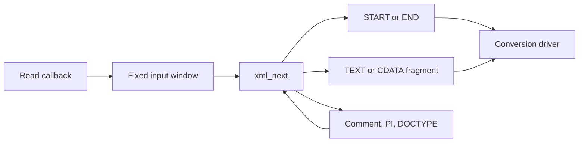

# XML parser
Active contributors: Artem

`src/xml_parse.c` is an allocation-free pull parser for the project's UTF-8 XML subset. It emits one bounded event at a time, validates skipped content too, and reports where input has been consumed rather than where a token began.

## Model and bounds

`XmlParser` owns a sliding window, a fixed stack of open element names and incremental UTF-8/position state. `xml_next` fills an `XmlEvent` with START, END, TEXT, EOF or ERROR; `src/convert.c` exposes only START, END and TEXT to public mappers.

| Bound in `src/xml_parse.h` | Value |
| --- | --- |
| Input window | 4096 bytes |
| Open elements | 64 |
| Element/attribute name | 63 bytes plus terminator |
| Attributes per element | 8 |
| Decoded attribute value | 255 UTF-8 bytes plus terminator |
| Text/CDATA fragment | At most 1023 bytes plus terminator |

The subsystem has one implementation unit and two focused C test files, `tests/test_xml_subset.c` and `tests/test_xml_coords.c` (2:1), alongside the original streaming groups in `tests/test_stream.c`. These bounds are storage limits, not field/document size limits.

## Pull flow

`fill` moves unread bytes to the window front and asks `XmlReadFn` for more. A positive short read is data, zero is EOF, and a negative value is failure. The public adapter in `src/convert.c` also rejects counts larger than the requested maximum.

`xml_next` handles sticky failure/EOF, a pending synthetic END for `<x/>`, and an optional leading BOM before dispatching to text, markup or continued CDATA parsing. Comments, processing instructions and DOCTYPE are consumed internally and never become mapper events. A failed parser never recovers without reinitialization.

## Accepted subset

| Construct | Current behavior in `src/xml_parse.c` |
| --- | --- |
| Encoding | UTF-8 only; optional BOM; UTF-16 is unsupported |
| XML declaration | At document start after BOM; required `version="1.0"`, optional encoding `UTF-8`/`utf-8`, optional standalone `yes`/`no`, ordered and unique |
| Elements | One root, matching names, bounded nesting; empty elements produce START then END |
| Attributes | Quoted values; duplicate names rejected; literal `<` rejected |
| References | Five predefined entities and decimal / lowercase-`x` hexadecimal numeric references |
| CDATA | Only inside an element; bounded TEXT fragments with `from_cdata=1`; reference spelling stays literal |
| Comments and PI | Skipped incrementally, including long bodies; malformed comments/targets and reserved mixed-case `xml` PI targets fail |
| DOCTYPE | At most one before the root; external identifier syntax checked but never resolved; internal subset skipped with quote/comment/PI awareness |

Declared entities do not become valid references. There is no network fetch, DTD validation, namespace resolution or DOM. Names retain colons and use the parser's byte-oriented name rules; do not advertise this as a complete XML implementation. The report/custom mapper may impose a narrower schema.

Every consumed byte passes UTF-8/XML-Char checks, including comments, PI, DTD bodies, skipped report records and trailing input. Invalid sequences, surrogates, out-of-range scalars and non-XML characters fail. Legal XML text can still fail later because the [font repertoire](layout-and-fonts.md) is narrower.

Literal CR/CRLF become LF in text/CDATA. Literal tab/LF/CR/CRLF become spaces in attributes. References are decoded separately, so referenced whitespace is not normalized as literal attribute whitespace. Text chunks finish at scalar boundaries, but mapper emission calls should still work incrementally.

## Consumed positions

`consume`, `stamp` and `xml_format_pos` implement the position contract (`src/xml_parse.c`, `src/xml_parse.h`):

- Line/column are 1-based; column counts Unicode scalars, with tab counting once.
- Byte offset is 0-based raw bytes consumed, including a leading BOM. The BOM adds no column.
- CR, LF and CRLF each end one line. References and CDATA delimiters count their source spelling.
- A tag event points just after `>`; an empty element's synthetic END has its START position.
- Looking ahead does not consume input. Counter overflow stops parsing rather than wrapping.

Malformed UTF-8 is reported when the containing parser path checks the latched bad-sequence state. Text/CDATA/comment/PI/DTD bodies usually check after each byte; text references check after the whole reference, tags after `>`, and cut-off text sequences before `<` or at EOF. A syntax/reference error found earlier wins. Do not interpret the result as an exact offending-byte pointer. The public header gives the edge-case contract.

The driver appends `at line L, column C, byte B` to XML/profile errors; public `KiEvent` retains only `byte_offset`. See [Data models](../reference/data-models.md) and [Debugging](../how-to-contribute/debugging.md).

## Change entry points

- Grammar: dispatch in `parse_markup`, with helpers such as `parse_pi`, `parse_xml_decl`, `skip_doctype` and `skip_internal_subset`.
- Text/references: `parse_text`, `parse_cdata`, `try_named`, `try_numeric`; test around the 4096-byte window and with one-byte reads.
- Position rules: centralize consumption in `consume`; add independent position oracles in `tests/test_xml_coords.c`.
- Limits: `src/xml_parse.h`; remember that event/public attribute bounds and mapper depth assumptions are coupled.

## Key source files

| File | Role |
| --- | --- |
| `src/xml_parse.c`, `src/xml_parse.h` | Parser, bounds, event shape and position rules |
| `src/convert.c` | Checked public reader adapter and event/cause translation |
| `tests/test_xml_subset.c` | Character contexts, declaration/DTD rules, chunk boundaries and selected tails |
| `tests/test_xml_coords.c` | Independent position oracle, counter overflow and profile/custom errors |
| `tests/test_stream.c` | Original parser, CDATA and bounded-state tests |
| `tests/corpus/xml/SHA256SUMS` | Audited negative-fixture manifest |

Related: [Conversion pipeline](conversion-pipeline.md), [Security](../security.md), [Testing](../how-to-contribute/testing.md).
